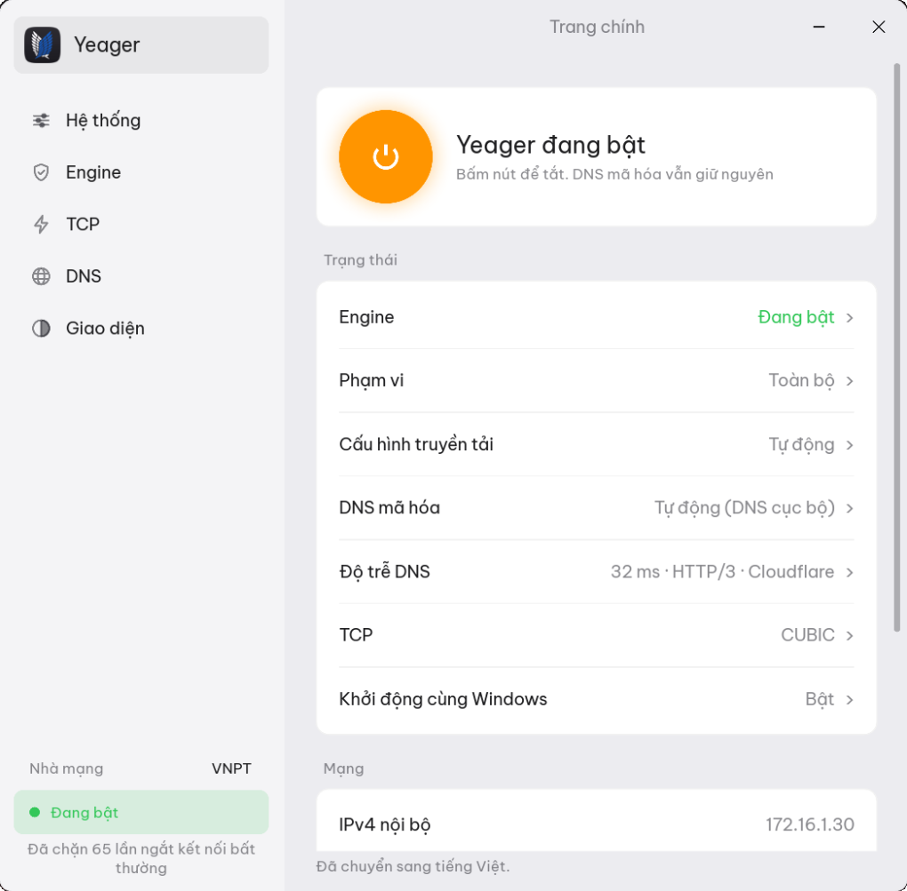
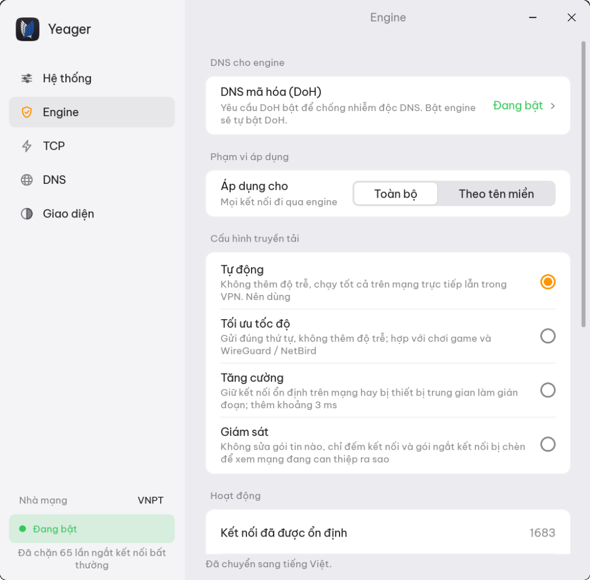
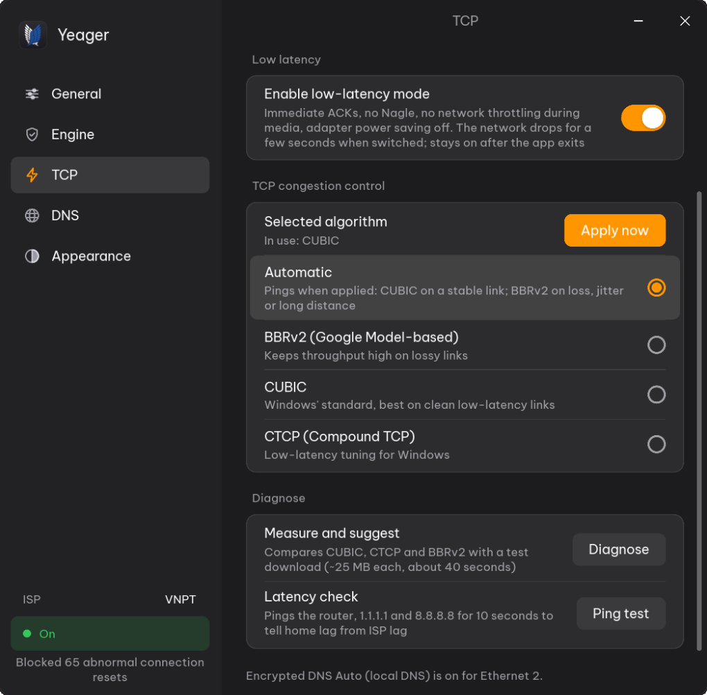
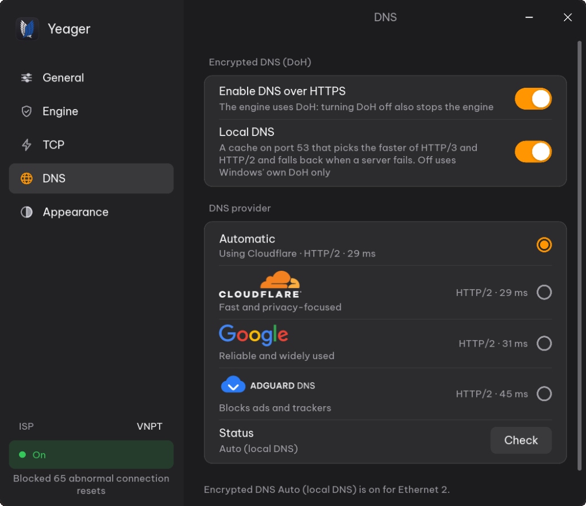
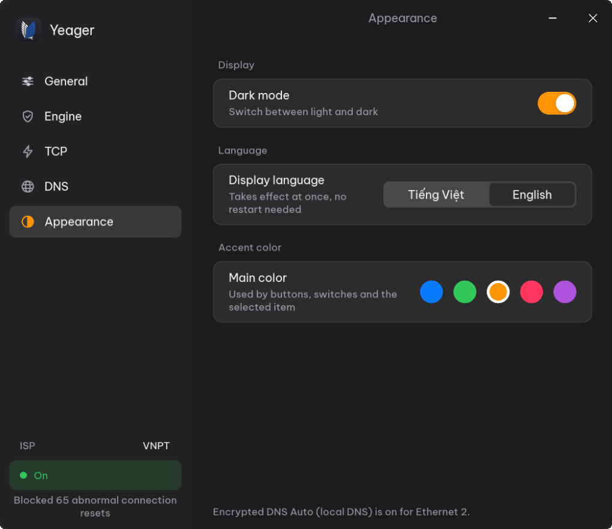
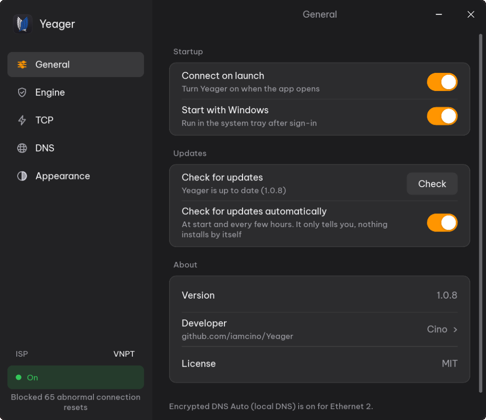

<div align="center">


# Yeager

**An easier, more open Internet on Windows — connection engine, TCP tuning and encrypted DNS in one native app.**

**English** · [Tiếng Việt](README.vi.md)

[](https://github.com/iamcino/Yeager/releases/latest)


[](LICENSE)

</div>

---

## Contents

- [What is Yeager?](#what-is-yeager)
  - [Screenshots](#screenshots)
- [Features](#features)
- [Requirements](#requirements)
- [Installation](#installation)
- [Getting started](#getting-started)
- [How it works](#how-it-works)
- [Privacy](#privacy)
- [Uninstalling](#uninstalling)
- [Building from source](#building-from-source)
- [FAQ](#faq)
- [Disclaimer](#disclaimer)
- [License and third-party software](#license-and-third-party-software)

## What is Yeager?

Yeager is a small Windows app that keeps websites and online services reachable
and responsive on networks that interfere with ordinary connections. It combines
three pieces that each solve one part of the problem:

| Component | What it does for you |
|-----------|----------------------|
| **Levi** — connection engine | Helps HTTPS connections that the local network keeps resetting or stalling get through, so sites and apps load normally. |
| **Erwin** — TCP tuning | Picks the best Windows TCP congestion-control algorithm for your link, and can measure it for you. |
| **Hange** — encrypted DNS | Resolves domain names over DNS over HTTPS (HTTP/3 or HTTP/2), so lookups can't be read or tampered with on the way. |

Yeager is **not** a VPN or a proxy. Your traffic goes straight to the site you
open, from your own IP address, and stays end-to-end encrypted. Nothing is
routed through third-party servers, and browsers and apps need no proxy
settings or extra certificates.

Everything is one native Rust binary that sits in the system tray, uses little
memory, and undoes every system change it makes.

### Screenshots

| Dashboard | Connection Engine (Levi) |
|:---:|:---:|
|  |  |
| **TCP Tuning (Erwin)** | **Encrypted DNS (Hange)** |
|  |  |
| **Appearance & Colors** | **General Settings** |
|  |  |

## Features

### Levi — connection engine

- **Pure native Rust.** Written entirely in Rust and linked into
  `yeager.exe`. Turning it on or off from the window or the tray calls native
  code in the same process: no helper processes, scripts or runtimes.
- **Self-contained driver.** The signed WinDivert driver (`WinDivert.dll`,
  `WinDivert64.sys`) is embedded in the binary and unpacked automatically when
  the engine starts. There is nothing extra to install.
- **Two scopes.**
  - *All*: works on every outgoing HTTPS (port 443) connection.
  - *Domain list*: works only on the domains you list (subdomains included,
    e.g. `discord.com`, `medium.com`, `steamcommunity.com`); everything else
    goes straight through at native speed.
- **Four transport profiles.**
  - *Auto* (default): picks *Fast*, which adds no delay and works on direct
    fibre lines as well as inside VPN tunnels such as WireGuard / NetBird.
  - *Fast*: splits the opening of each connection into three pieces sent in
    order, so nothing is added to latency; good for games and VPN tunnels.
  - *Hardened*: sends the pieces out of order with a short, calibrated pause
    (about 3.4 ms) for networks whose equipment tampers harder with streams.
  - *Observe*: changes nothing and only counts connections and injected resets,
    to check safely how the network behaves.

  Pick one on the **Engine** page; `levi.exe` takes `--profile auto|fast|hardened`.
- **No waiting in line.** The packet loop runs at wire speed (under 20 µs per
  packet) and hands per-connection work to a fixed pool of 4–6 worker threads,
  so a page that opens 20–30 connections at once still loads instantly and
  Windows never has to spin up new threads under load.
- **Built for heavy traffic.** Large driver queues (8192 packets, 32 MB) keep
  downloads, 4K video and games from dropping packets while connections are
  being set up.
- **Resists tampering.** Connection resets injected by the network before the
  real server answers are dropped at the driver level, so the connection stays
  open for the genuine reply. Only resets that arrive while a connection is
  still being opened (about 3.5 s) are dropped; a real server closing an
  established connection is let through, so no connection is left hanging.
- **Leaves your local network alone.** Traffic to private and local addresses
  (192.168.x.x, 10.x.x.x, 172.16–31.x.x, loopback, link-local and IPv6 ULA) and
  to IPv6 devices on the same /64 network as your PC, such as a NAS or a TV,
  goes straight through at full LAN speed.
- **Live counters.** The engine counts connections it has handled, connections
  it has stabilised and injected resets it has dropped; the Engine page shows
  them live.
- **Light on CPU.** Only packets that open a connection are inspected; ACKs
  and keepalives pass straight through, and the hot path allocates no memory.
- **Stays out of DNS.** Never touches port 53 or the encrypted DNS connections
  Yeager itself makes, so name resolution is unaffected.
- **Antivirus-friendly.** Does not inject fake packets or unusual TCP flags,
  which security software (e.g. Bitdefender, Kaspersky) often flags.
- **Clean lifecycle.** Starts and stops in well under two seconds and leaves no
  process or driver behind. Exposed to the app as `levi::start`,
  `levi::start_with_profile`, `levi::stop` and `levi::is_running`.
- **Headless CLI.** A separate `levi.exe` (~486 KB) runs the engine without
  the UI, for servers or scripts, and prints a summary of the counters when it
  stops. See [`crates/levi/CLI.md`](crates/levi/CLI.md).

### Erwin — TCP tuning

- Choose the congestion-control algorithm Windows uses: **Auto**, **BBRv2**,
  **CUBIC** or **CTCP**.
- **Auto** pings Cloudflare and Google when you apply it: a stable link gets
  CUBIC; packet loss, jitter or long-distance paths get BBRv2.
- **Diagnose** measures throughput and latency under load with CUBIC, CTCP and BBRv2
  and recommends the fastest one, which you can apply with one click.
- **Fully reversible.** Before its first change Yeager saves your current
  settings and puts them back when you turn TCP tuning off, quit the app, or
  start it again after a crash. **Restore Windows defaults** puts back your
  original settings, or Windows' own defaults (CUBIC, no pacing), and turns
  low-latency mode off.
- Works on its own: independent of the engine and of DNS.

### Hange — encrypted DNS

- **DNS over HTTPS** with **Cloudflare**, **Google** or **AdGuard** (blocks ads
  and trackers), or **Automatic**: whichever of Cloudflare and Google answers
  faster. Each provider shows the transport and latency it gets on your network.
- **Local DNS.** A resolver on `127.0.0.1:53` / `[::1]:53` with a 4096-entry
  cache. It tries every server address over both HTTP/3 and HTTP/2 at once and
  keeps the route that answers fastest, so a slow or broken address or
  transport never holds lookups up. While you browse, the connection is kept
  warm so the next lookup answers at once.
- **Rides out outages.** While a server is unreachable, recently visited sites
  are answered from the cache, and if the chosen provider stays down for 10
  seconds another one stands in until it is back (the app says so).
- **No plaintext fallback.** Each network adapter lists the local resolver
  first and the provider's servers, with Windows' built-in DoH required, after
  it. If the local resolver stops, Windows keeps using encrypted DNS.
- Configured through the Windows IP Helper API, not scripts or raw registry
  edits, so antivirus behaviour monitors don't mistake it for a DNS hijacker.
- Trusts the Windows certificate store, so it keeps working with antivirus
  "encrypted web scan" features.
- **Check** shows which transport is in use and whether DNS is leaking.
- Turning it off resets the adapters to the DNS from your router (DHCP);
  leftovers from a crash are cleaned up on the next launch.

### App

- Vietnamese and English interface, switchable at any time.
- Light and dark mode, adjustable accent color.
- Lives in the system tray; closing the window keeps Yeager running.
- Shows your ISP in the sidebar (from Cloudflare, once at start and again
  when you run **Diagnose**).
- **Updates itself** from GitHub Releases when you agree, with the download
  checked against its SHA-256 checksum.
- Optional **connect on launch** and **start with Windows** (an elevated
  logon task, so no UAC prompt every time you sign in).
- **The engine needs encrypted DNS:** turning the engine on turns DoH on, and
  turning DoH off stops the engine. DoH and TCP tuning can run on their own.

## Requirements

- Windows 11, 64-bit. (Windows' built-in DNS over HTTPS, which Yeager relies on,
  is only available on Windows 11.)
- Administrator rights (changing TCP and DNS settings and loading the driver
  require them; the app asks once when it starts).
- BBRv2 needs Windows 11 22H2 or later. On older builds, use CUBIC or CTCP.

## Installation

1. Download `Yeager-Setup-<version>.exe` from the
   [latest release](https://github.com/iamcino/Yeager/releases/latest).
2. Run it and accept the administrator prompt.
3. If your antivirus or firewall asks about `yeager.exe`, allow it. Yeager
   needs network access for encrypted DNS and the speed test.

The portable zip (`Yeager-<version>-portable-x64.zip`) runs without
installation.

### Updating

Yeager checks for a new release when it starts and every few hours (turn this
off under **General → Updates**). A new version shows as **↑ Update to …** in
the sidebar and the tray menu, and nothing installs until you press
**Update**. Yeager then downloads the new `yeager.exe` from GitHub, checks it
against the release's SHA-256 checksum, puts it in place of the running one,
restores TCP and DNS, and restarts (with the engine back on if it was on).
**General → Updates → Check** looks right away. Installed and portable copies
update the same way.

## Getting started

1. Open Yeager and click the logo to reach the **home** page.
2. Press the power button. Yeager turns on encrypted DNS and the engine.
3. To limit the engine to particular sites, open **Engine**, set
   **Apply to** to *Domain list*, and add the domains you need.
4. Optionally open **TCP**, press **Diagnose**, then **Apply suggestion**.
5. Open **DNS** and press **Check** to confirm lookups are encrypted.

## How it works

```
 Browser / apps
       │
       ▼
 Windows TCP/IP stack ──── Erwin: congestion control (BBRv2 / CUBIC / CTCP)
       │
       ├── DNS queries ──► Hange: local DNS ──► DoH (HTTP/3 or HTTP/2) ──► Cloudflare / Google / AdGuard
       │
       └── HTTPS ───────► Levi: connection engine (All / Domain list) ──► Internet
```

Each part can run independently, except that the engine always runs with
encrypted DNS. More detail is in the [design document](docs/DESIGN.md).

Repository layout:

| Crate | Role |
|-------|------|
| `crates/app` | Slint UI, system tray, orchestration (`yeager.exe`) |
| `crates/levi` | Connection engine library and `levi.exe` CLI |
| `crates/erwin` | TCP congestion control, configuration, launch at login |
| `crates/hange` | Local DNS over HTTPS (HTTP/3 and HTTP/2) and system DoH setup |
| `crates/common` | Shared types, configuration model, helpers |

## Privacy

Yeager has no account, no telemetry, no analytics and no ads. Settings stay on
your computer in `%LOCALAPPDATA%\Yeager`. The only connections it makes on its
own are to your chosen DNS provider, to Cloudflare once at start to name your
ISP, to GitHub to look for a new release
(unless you turn that off), and, when you run **Diagnose** or **Auto**, to
Cloudflare and Google for pings and a short speed test. See
[PRIVACY.md](PRIVACY.md).

## Uninstalling

Use **Settings → Apps → Yeager → Uninstall**. The uninstaller stops Yeager,
removes the launch-at-login task and deletes `%LOCALAPPDATA%\Yeager`. Turn
Yeager off before uninstalling so your original TCP and DNS settings are put
back immediately (they are also restored the next time Yeager starts).

## Building from source

You need the Rust toolchain and a resource compiler for the embedded icon and
administrator manifest: `windres` (from [w64devkit](https://github.com/skeeto/w64devkit)
or MSYS2) for the GNU toolchain, or the Windows SDK `rc.exe` for MSVC.

```powershell
# builds the app and copies it to dist\yeager.exe
./build.ps1

# or manually
cargo build --release            # target\release\yeager.exe
cargo build --release -p levi    # target\release\levi.exe (CLI)
```

Build the installer with [Inno Setup](https://jrsoftware.org/isinfo.php):

```powershell
iscc installer\setup.iss         # dist\Yeager-Setup-<version>.exe
```

From Linux you can type-check the Windows build with
`cargo check --target x86_64-pc-windows-gnu` (needs `mingw-w64`).

Icons are reduced from the master artwork in `assets/icons/src/yeager.png`,
each size natively. The tray icon's rim lights up in the UI accent color
while Yeager is on:

```bash
python3 tools/make_icons.py      # needs Pillow and numpy
```

Contributions are welcome; please read [CONTRIBUTING.md](CONTRIBUTING.md).

## FAQ

**Is Yeager a VPN? Does it hide my IP address?**
No. Your connections go directly to the sites you visit from your own IP
address. Yeager does not anonymise you.

**Why does it need administrator rights?**
Changing TCP and DNS settings and loading the network driver are
system-level operations in Windows.

**My antivirus or firewall complained.**
Yeager loads the WinDivert network driver and runs a local DNS resolver,
which some security products watch closely. Allow `yeager.exe` in your
antivirus and firewall. Yeager never uses hidden PowerShell or fake packets.

**Will it slow down my games?**
No noticeable effect on general traffic, but if you prefer, use the
*Domain list* scope so the engine only touches the sites you choose.

**Something stopped working. How do I undo everything?**
Turn Yeager off, or press **Restore Windows defaults** on the TCP page.
Quitting the app also restores TCP and DNS settings.

## Disclaimer

Yeager is free, open-source software provided **"as is", without warranty of any kind** under the [MIT License](LICENSE).

- **Not a VPN or proxy:** Yeager does not hide your identity or IP address, and is not an anonymity tool.
- **Your responsibility:** You are responsible for using Yeager in compliance with applicable local laws, regulations, and provider terms.
- **System changes:** Yeager adjusts Windows TCP and DNS parameters and loads the WinDivert driver. While settings are automatically backed up and restored upon exit, the authors assume no liability for connectivity interruptions, data loss, or system issues.
- **Third-party services:** Cloudflare and Google DNS/speed-test services operate under their own terms and privacy policies.
- **No affiliation:** Yeager is an independent project and is not affiliated with Microsoft, Cloudflare, Google, WinDivert, Slint, or *Attack on Titan*.

See the full [DISCLAIMER.md](DISCLAIMER.md) for details.

## License and third-party software

Yeager's source code is released under the [MIT License](LICENSE).

The app includes third-party components under their own licenses: the
WinDivert driver (LGPL v3), the Slint UI toolkit (Slint Royalty-free License
2.0), the Be Vietnam Pro font (SIL OFL 1.1) and a number of Rust crates (mostly
MIT / Apache-2.0). Details are in [THIRD-PARTY-NOTICES.md](THIRD-PARTY-NOTICES.md).

Please read the [disclaimer](DISCLAIMER.md) before use. Report security issues
as described in [SECURITY.md](SECURITY.md). Changes are listed in the
[changelog](CHANGELOG.md).

<p align="center">
  <a href="https://slint.dev">
    <picture>
      <source media="(prefers-color-scheme: dark)" srcset="assets/icons/made-with-slint-dark.svg">
      <source media="(prefers-color-scheme: light)" srcset="assets/icons/made-with-slint-light.svg">
      
    </picture>
  </a>
</p>
