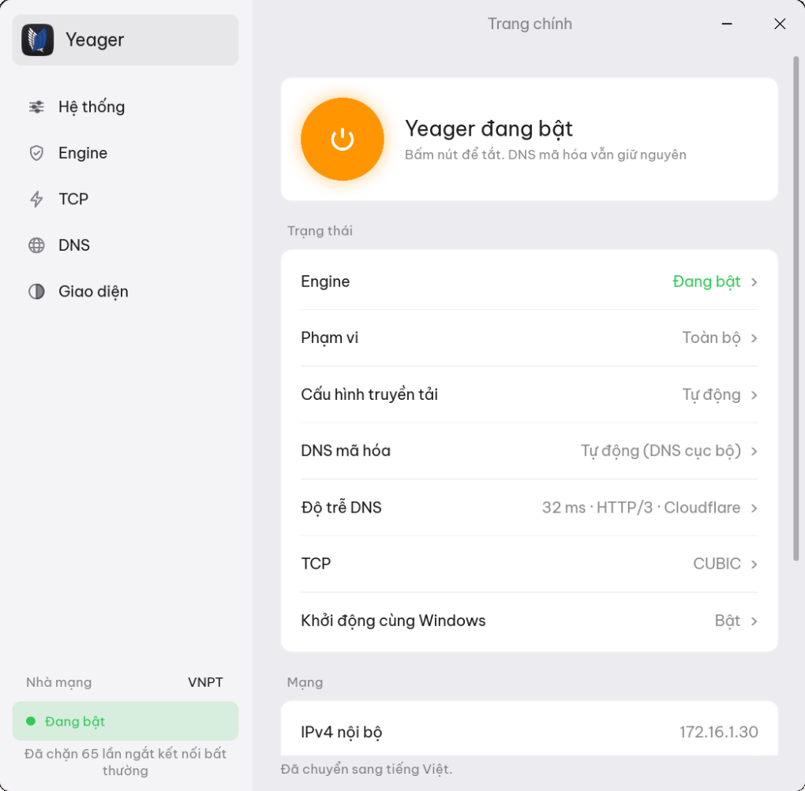
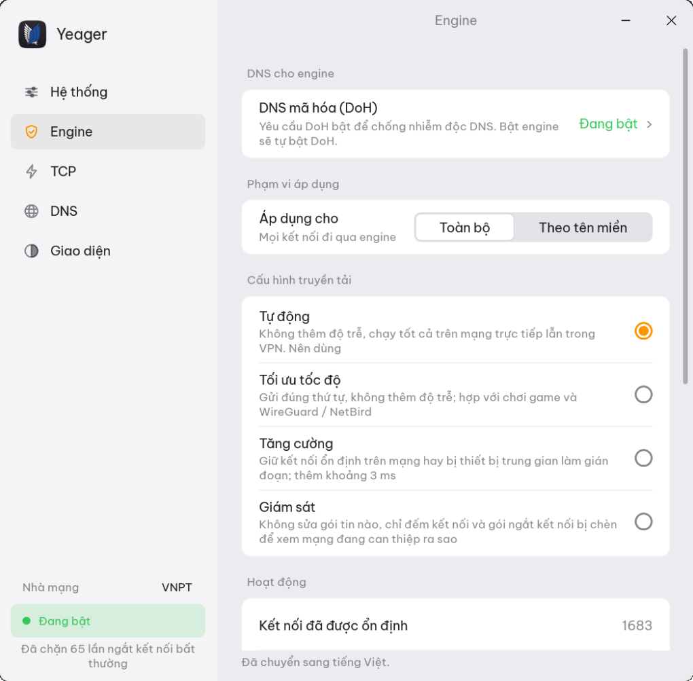
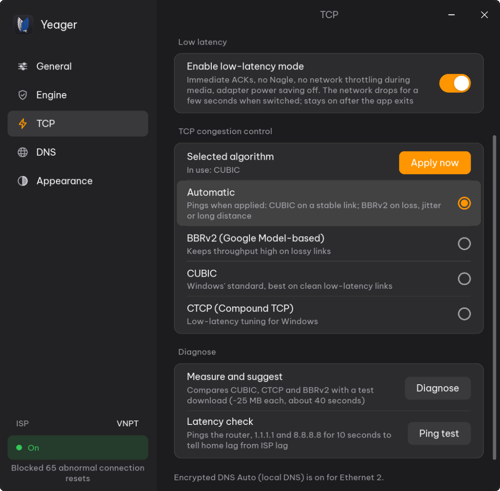
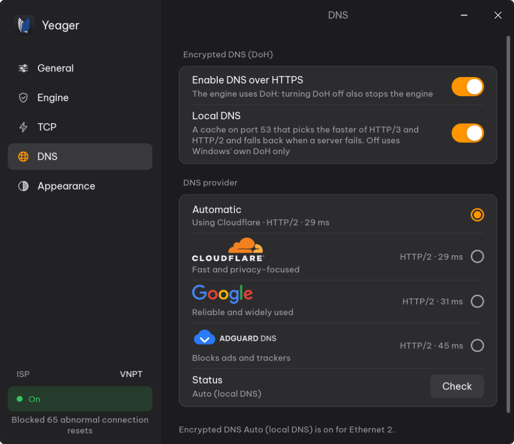

<div align="center">


# Yeager

**A smoother, more open Internet on Windows 11, in one switch.**<br>
A connection engine, TCP tuning and encrypted DNS in a single native app. Not a VPN: your traffic still goes straight to the site, from your own IP.

**English** · [Tiếng Việt](README.vi.md)

[](https://gitlab.com/cino-group/yeager/-/releases)


[](LICENSE)

### ⬇ Download the installer: [from GitHub](https://github.com/iamcino/Yeager/releases/latest) · [from GitLab](https://gitlab.com/cino-group/yeager/-/releases/permalink/latest/downloads/Yeager-Setup.exe)

Releases: [GitHub](https://github.com/iamcino/Yeager/releases) · [GitLab](https://gitlab.com/cino-group/yeager/-/releases) · [What's new](CHANGELOG.md) · [Report a bug](https://github.com/iamcino/Yeager/issues)



</div>

---

## Up and running in a minute

1. **Download** `Yeager-Setup-<version>.exe` [from GitHub](https://github.com/iamcino/Yeager/releases/latest) or [from GitLab](https://gitlab.com/cino-group/yeager/-/releases/permalink/latest/downloads/Yeager-Setup.exe), run it and accept the administrator prompt.
2. **Press the power button** on the home page. Yeager turns on encrypted DNS and the connection engine.
3. **Browse as usual.** Sites that used to stall or reset now load normally.

That's it. Yeager lives in the notification area (bottom right of the
taskbar); closing the window keeps it running. If Windows or your antivirus
shows a warning, see [Windows and antivirus warnings](#windows-and-antivirus-warnings).

> Prefer not to install? The portable zip (`Yeager-<version>-portable-x64.zip`)
> runs from any folder and updates itself the same way.

## Why Yeager

| | |
|---|---|
| 🌐 **Sites load again** | Levi, the connection engine, helps HTTPS connections that your network keeps resetting or stalling get through, for every site or only the ones you list. |
| 🚀 **Not a VPN** | No proxy, no third-party server, no extra certificate. Traffic goes straight to the site from your own IP and stays end-to-end encrypted, so speed and latency stay native. |
| 🔒 **Private DNS** | Hange resolves names over DNS over HTTPS (HTTP/3 or HTTP/2) with Cloudflare, Google or AdGuard, and never falls back to plain DNS. |
| ⚡ **Faster TCP** | Erwin measures your link and picks the best Windows congestion control: BBRv2, CUBIC or CTCP. |
| ↩️ **Fully reversible** | Every TCP and DNS change is saved first and put back when you turn Yeager off, quit, or start it again after a crash. |
| 🪶 **Light and native** | One Rust binary with the network driver built in. No services, no scripts, no runtimes, little memory. |
| 🛡️ **Safe updates** | Tells you when a new version is out, always asks first, and checks the download against the release's SHA-256 list. |

## Features

### Levi: connection engine

- **Two scopes.** *All* works on every outgoing HTTPS connection. *Domain list*
  works only on the domains you add (subdomains included, such as
  `discord.com` or `medium.com`); everything else goes straight through.
- **Four profiles.** *Auto* (default) and *Fast* add no delay and suit games,
  fibre and VPN tunnels such as WireGuard or NetBird. *Hardened* is for
  networks that interfere harder. *Observe* changes nothing and only counts
  what the network does, to check it safely.
- **Resists tampering.** Resets injected by the network before the real server
  answers are dropped, so the connection stays open for the genuine reply. A
  real server closing a connection is always let through.
- **Leaves your local network alone.** Private and local addresses, and IPv6
  devices on your own /64 such as a NAS or a TV, go straight through at LAN speed.
- **Built for heavy traffic.** Pages that open 20–30 connections at once,
  downloads, 4K video and games keep their speed; only the packets that open a
  connection are inspected.
- **Antivirus-friendly.** No fake packets or unusual TCP flags, and DNS
  (port 53 and Yeager's own encrypted DNS) is never touched.
- **Live counters** on the Engine page: connections handled, stabilised, and
  injected resets dropped.

### Erwin: TCP tuning

- Choose **Auto**, **BBRv2**, **CUBIC** or **CTCP**. *Auto* pings Cloudflare and
  Google when you apply it: a stable link gets CUBIC; loss, jitter or long
  paths get BBRv2.
- **Diagnose** measures throughput and latency under load with each algorithm
  and recommends the fastest, applied with one click.
- **Restore Windows defaults** puts back your original settings, or Windows'
  own defaults, at any time.
- Works on its own, without the engine or DNS.

### Hange: encrypted DNS

- **Cloudflare**, **Google**, **AdGuard** (blocks ads and trackers), or
  **Automatic**, which uses whichever of Cloudflare and Google answers faster.
- **Local resolver** on `127.0.0.1` and `[::1]` with a 4096-entry cache. It
  races every server address over HTTP/3 and HTTP/2 and keeps the fastest
  route warm, so lookups answer at once.
- **Rides out outages.** Recently visited sites are answered from the cache,
  and if your provider stays down for 10 seconds another one stands in until
  it is back.
- **No plaintext fallback.** If the local resolver stops, Windows' own DoH
  keeps DNS encrypted.
- **Check** shows the transport in use and whether DNS is leaking.

### App

- Vietnamese or English interface, light or dark, your choice of accent color.
- **Connect on launch** and **start with Windows** without a UAC prompt at every sign-in.
- Shows your ISP in the sidebar.
- The engine always runs with encrypted DNS: turning the engine on turns DoH
  on. DoH and TCP tuning can each run on their own.

| Engine (Levi) | TCP tuning (Erwin) | Encrypted DNS (Hange) |
|:---:|:---:|:---:|
|  |  |  |

## Quick tips

| To… | Do this |
|---|---|
| Turn everything on or off | The power button on the home page (click the logo to get there) |
| Use the engine only for some sites | **Engine** › **Apply to** › *Domain list*, then add the domains |
| Get the best TCP setting for your link | **TCP** › **Diagnose** › **Apply suggestion** |
| Confirm DNS is encrypted | **DNS** › **Check** |
| Undo every TCP change | **TCP** › **Restore Windows defaults** |
| Check for a new version now | **General** › **Updates** › **Check** |

## System requirements

- **Windows 11 x64** (build 22000 or later) or **Windows Server 2022** (build 20348 or later).
- **Administrator rights**: changing TCP and DNS settings and loading the
  network driver are system-level operations. The app asks once when it starts.
- BBRv2 needs Windows 11 22H2 or later; older builds fall back to CUBIC or CTCP.

Windows 10 is not supported and won't be. It no longer gets security updates,
which matters for software that runs as administrator with a network driver,
and it lacks the native DNS over HTTPS APIs that Yeager builds on. The
installer and the app both refuse to run on older Windows.

## Updates

Yeager checks for a new version when it starts and every 6 hours. When one is
out, **↑ Update to …** shows in the sidebar and the tray menu. Nothing is
installed until you press **Update**. Yeager then downloads the new
`yeager.exe`, checks it against the release's `SHA256SUMS.txt`, swaps it in,
restores TCP and DNS, and restarts (with the engine back on if it was on).

To check right away: **General › Updates › Check**. To stop automatic checks,
turn them off in the same place.

The in-app updater reads releases from GitHub. If GitHub is unreachable from
your network, download the latest installer [from GitLab](https://gitlab.com/cino-group/yeager/-/releases/permalink/latest/downloads/Yeager-Setup.exe)
and run it over your current installation; your settings are kept.

## FAQ

**Is Yeager a VPN? Does it hide my IP address?**
No. Your connections go directly to the sites you visit, from your own IP
address. Yeager does not anonymise you.

**Will it slow down my games?**
No noticeable effect. If you'd rather it not touch games at all, use the
*Domain list* scope so the engine only works on the sites you choose.

**Does Yeager collect any data?**
No account, no telemetry, no analytics, no ads. Settings stay in
`%LOCALAPPDATA%\Yeager`. The only connections it makes on its own are to your
DNS provider, Cloudflare once at start to name your ISP, GitHub for the update
check, and Cloudflare and Google when you run **Diagnose** or *Auto*. See the
[privacy policy](PRIVACY.md).

**Why both GitHub and GitLab?**
Every release is published in both places. If one of them is unreachable from
your network, download from the other. The source code is on both
[GitHub](https://github.com/iamcino/Yeager) and [GitLab](https://gitlab.com/cino-group/yeager) too.

**Something stopped working. How do I undo everything?**
Turn Yeager off, or quit it: TCP and DNS go back to how they were. **TCP ›
Restore Windows defaults** also resets TCP to Windows' own defaults.

**How do I uninstall it?**
Turn Yeager off first, then **Settings › Apps › Yeager › Uninstall**. The
uninstaller stops Yeager, removes its sign-in task and deletes
`%LOCALAPPDATA%\Yeager`. Anything left over is restored the next time Yeager
starts, if you reinstall.

**Is there a command-line version?**
`levi.exe` runs the connection engine without the interface, for servers and
scripts. It isn't part of the regular downloads; build it from source as
described in [`crates/levi/CLI.md`](crates/levi/CLI.md).

## Troubleshooting

### Windows and antivirus warnings

Yeager releases are digitally signed, but with the project's own certificate
rather than a commercial one. So Windows may show "Windows protected your PC"
or "Unknown publisher" the first time. Click **More info › Run anyway**.

Some antivirus products also watch Yeager closely, because it loads the
WinDivert network driver and runs a local DNS resolver. Allow `yeager.exe` in
your antivirus and firewall. To be sure your download is genuine:

- **Download only** from the official release pages on [GitHub](https://github.com/iamcino/Yeager/releases) or [GitLab](https://gitlab.com/cino-group/yeager/-/releases).
- **Check the signature:** open PowerShell in the file's folder and run
  `(Get-AuthenticodeSignature .\yeager.exe).SignerCertificate.Thumbprint`.
  For current releases it must print `9131F99C0B198E81FBA0F5818D0637B4A14D4CF1`.
- **Check the hash** against `SHA256SUMS.txt` from the same release.

Every thumbprint Yeager has used, the VirusTotal results and the full list of
network endpoints are in [SECURITY.md](SECURITY.md#verifying-a-download).

### A site still doesn't load

- Make sure both the engine and encrypted DNS show as on, and run **DNS › Check**.
- On the **Engine** page, try the *Hardened* profile; some networks need it.
- With *Domain list*, check that the site's domain is in the list. Sites often
  load parts from other domains too (images, video, APIs); add those as well,
  or switch to *All*.

### My Internet feels slower

Run **TCP › Diagnose** and apply the suggestion, or press **Restore Windows
defaults**. If you're inside a VPN tunnel, use the *Auto* or *Fast* profile.

## For developers

Yeager is written in Rust with a [Slint](https://slint.dev) interface. It
is split into crates: `app` (interface, tray, orchestration), `levi`
(connection engine on WinDivert), `erwin` (TCP), `hange` (DNS over HTTPS) and
`common`.

```
 Browser / apps
       │
       ▼
 Windows TCP/IP ──── Erwin: congestion control (BBRv2 / CUBIC / CTCP)
       │
       ├── DNS ────► Hange: local resolver ──► DoH (HTTP/3 or HTTP/2) ──► Cloudflare / Google / AdGuard
       │
       └── HTTPS ──► Levi: connection engine (All / Domain list) ──► Internet
```

- [Design document](docs/DESIGN.md): how each part works and why.
- [Build and release](docs/BUILD.md): building from source, the installer, signing, and publishing on GitHub and GitLab.
- [Contributing](CONTRIBUTING.md): bug reports and pull requests.

## License and credits

Copyright (C) 2026 Cino and the Yeager contributors

Yeager is free, open-source software under the [MIT License](LICENSE). It
includes third-party components under their own licenses: the WinDivert
driver (LGPL v3), the Slint toolkit (Slint Royalty-free License 2.0), the Be
Vietnam Pro font (SIL OFL 1.1) and Rust crates, mostly MIT or Apache-2.0.
Details are in [THIRD-PARTY-NOTICES.md](THIRD-PARTY-NOTICES.md).

Yeager is provided "as is", without warranty. You are responsible for using it
in line with local laws and your provider's terms. It is an independent
project, not affiliated with Microsoft, Cloudflare, Google, WinDivert, Slint
or *Attack on Titan*. See the [disclaimer](DISCLAIMER.md) and the
[security policy](SECURITY.md).

<p align="center">
  <a href="https://slint.dev">
    <picture>
      <source media="(prefers-color-scheme: dark)" srcset="assets/icons/made-with-slint-dark.svg">
      <source media="(prefers-color-scheme: light)" srcset="assets/icons/made-with-slint-light.svg">
      
    </picture>
  </a>
</p>
