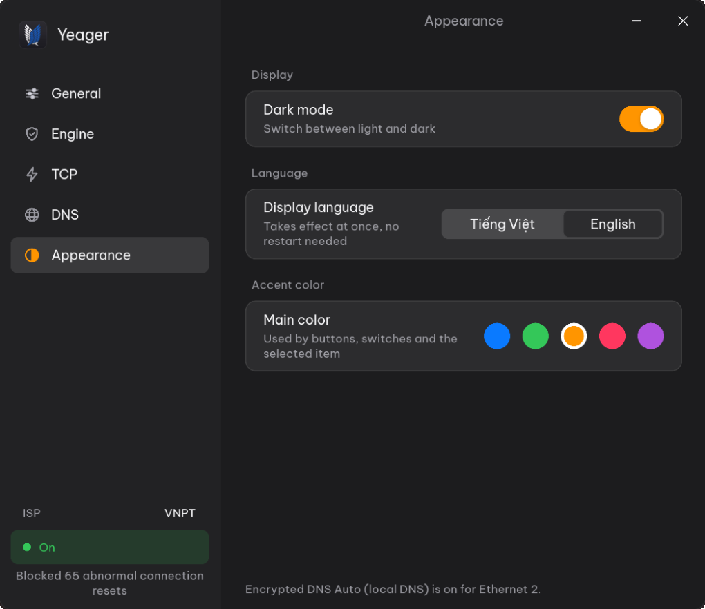
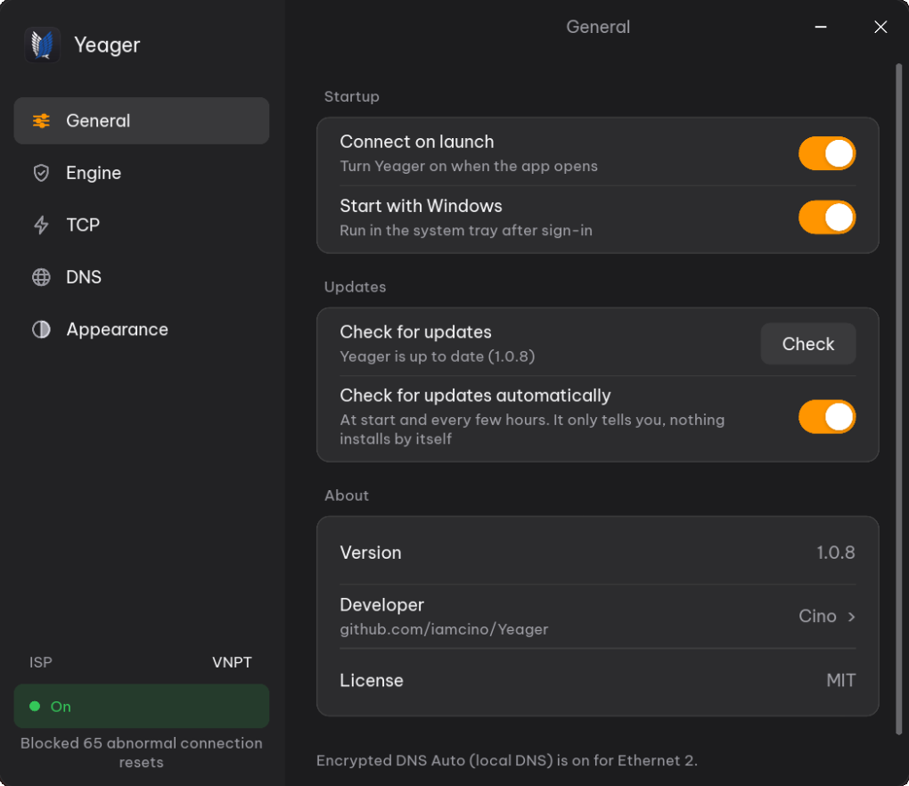

<div align="center">


# Yeager

**Internet dễ dàng và cởi mở hơn trên Windows: engine kết nối, tối ưu TCP và DNS mã hóa trong một ứng dụng gốc.**

[English](README.md) · **Tiếng Việt**

[](https://github.com/iamcino/Yeager/releases/latest)


[](LICENSE)

</div>

---

## Mục lục

- [Yeager là gì?](#yeager-là-gì)
  - [Giao diện ứng dụng](#giao-diện-ứng-dụng)
- [Tính năng](#tính-năng)
- [Yêu cầu hệ thống](#yêu-cầu-hệ-thống)
- [Cài đặt](#cài-đặt)
- [Bắt đầu sử dụng](#bắt-đầu-sử-dụng)
- [Cách hoạt động](#cách-hoạt-động)
- [Quyền riêng tư](#quyền-riêng-tư)
- [Gỡ cài đặt](#gỡ-cài-đặt)
- [Build từ mã nguồn](#build-từ-mã-nguồn)
- [Câu hỏi thường gặp](#câu-hỏi-thường-gặp)
- [Bảo mật & kết quả quét virus](#bảo-mật--kết-quả-quét-virus)
- [Tuyên bố miễn trừ trách nhiệm](#tuyên-bố-miễn-trừ-trách-nhiệm)
- [Giấy phép và phần mềm bên thứ ba](#giấy-phép-và-phần-mềm-bên-thứ-ba)

## Yeager là gì?

Yeager là một ứng dụng Windows nhỏ gọn giúp các trang web và dịch vụ trực tuyến
luôn truy cập được và phản hồi nhanh, kể cả trên những mạng hay can thiệp vào
kết nối thông thường. Ứng dụng gồm ba thành phần, mỗi phần giải quyết một khía
cạnh của vấn đề:

| Thành phần | Giúp gì cho bạn |
|------------|-----------------|
| **Levi**: engine kết nối | Giúp các kết nối HTTPS hay bị mạng nội bộ ngắt hoặc làm treo đi qua được, để trang web và ứng dụng tải bình thường. |
| **Erwin**: tối ưu TCP | Chọn thuật toán điều khiển tắc nghẽn TCP phù hợp nhất với đường truyền của bạn, và có thể đo giúp bạn. |
| **Hange**: DNS mã hóa | Phân giải tên miền qua DNS over HTTPS (HTTP/3 hoặc HTTP/2), để truy vấn không bị đọc trộm hay sửa đổi trên đường đi. |

Yeager **không phải** VPN hay proxy. Lưu lượng của bạn đi thẳng tới trang web
bạn mở, bằng chính địa chỉ IP của bạn, và vẫn được mã hóa đầu cuối. Không có gì
đi vòng qua máy chủ bên thứ ba, trình duyệt và ứng dụng không cần cấu hình proxy
hay cài thêm chứng chỉ.

Toàn bộ là một file Rust gốc duy nhất, chạy ở khay hệ thống, tốn rất ít bộ nhớ
và hoàn tác mọi thay đổi hệ thống mà nó tạo ra.

### Giao diện ứng dụng

| Trang chính (Dashboard) | Engine kết nối (Levi) |
|:---:|:---:|
|  |  |
| **Tối ưu TCP (Erwin)** | **DNS mã hóa (Hange)** |
|  |  |
| **Giao diện & Màu sắc** | **Cài đặt hệ thống** |
|  |  |

## Tính năng

### Levi: engine kết nối

- **Thuần Rust.** Viết hoàn toàn bằng Rust và liên kết thẳng vào
  `yeager.exe`. Bật hoặc tắt từ cửa sổ hay khay hệ thống là gọi mã gốc ngay
  trong cùng tiến trình: không tiến trình phụ, không script, không runtime ngoài.
- **Tự mang driver.** Driver WinDivert đã ký số (`WinDivert.dll`,
  `WinDivert64.sys`) được nhúng sẵn trong file chạy và tự giải nén khi engine
  khởi động. Người dùng không phải cài thêm gì.
- **Hai phạm vi áp dụng.**
  - *Toàn bộ*: áp dụng cho mọi kết nối HTTPS (cổng 443) đi ra.
  - *Theo tên miền*: chỉ áp dụng cho các tên miền trong danh sách của bạn (gồm
    cả tên miền con, ví dụ `discord.com`, `medium.com`, `steamcommunity.com`);
    mọi trang khác đi thẳng với tốc độ mạng gốc.
- **Bốn cấu hình truyền tải.**
  - *Tự động* (mặc định): chọn *Tối ưu tốc độ*, không thêm độ trễ và chạy tốt
    cả trên đường cáp quang trực tiếp lẫn trong đường hầm VPN như WireGuard /
    NetBird.
  - *Tối ưu tốc độ*: chia phần mở đầu của mỗi kết nối thành ba đoạn gửi đúng
    thứ tự, không thêm độ trễ; hợp với chơi game và VPN.
  - *Tăng cường*: gửi các đoạn đảo thứ tự, kèm một quãng nghỉ ngắn đã hiệu chỉnh
    (khoảng 3,4 ms), dành cho mạng có thiết bị can thiệp luồng mạnh hơn.
  - *Giám sát*: không thay đổi gói tin nào, chỉ đếm kết nối và gói reset bị
    chèn, để kiểm tra an toàn xem mạng đang hoạt động ra sao.

  Chọn ở trang **Engine**; `levi.exe` chọn được bằng
  `--profile auto|fast|hardened`.
- **Không phải xếp hàng.** Vòng lặp xử lý gói chạy ở tốc độ đường truyền (dưới
  20 µs mỗi gói) và chuyển phần việc của từng kết nối cho một nhóm cố định 4–6
  luồng xử lý, nên trang web mở 20–30 kết nối cùng lúc vẫn tải tức thì và
  Windows không phải tạo luồng mới khi tải nặng.
- **Chịu tải lớn.** Hàng đợi driver lớn (8192 gói, 32 MB) giúp tải file, xem
  video 4K hay chơi game không bị rớt gói trong lúc kết nối đang được thiết lập.
- **Chống can thiệp.** Các gói ngắt kết nối (reset) do mạng chèn vào trước khi
  máy chủ thật kịp trả lời bị bỏ ngay ở tầng driver, nên kết nối vẫn mở để nhận
  phản hồi thật. Chỉ gói reset tới trong lúc kết nối đang được mở (khoảng 3,5
  giây) mới bị bỏ; máy chủ thật đóng một kết nối đã thiết lập thì vẫn được cho
  qua, nên không kết nối nào bị treo.
- **Không động tới mạng nội bộ.** Kết nối tới địa chỉ riêng và cục bộ
  (192.168.x.x, 10.x.x.x, 172.16–31.x.x, loopback, link-local và IPv6 ULA) và
  tới thiết bị IPv6 cùng mạng /64 với máy, như NAS hay TV, đi thẳng với tốc độ
  mạng LAN.
- **Bộ đếm trực tiếp.** Engine đếm số kết nối đã xử lý, số kết nối đã được ổn
  định và số gói reset giả đã bỏ; trang Engine hiện các số này trực tiếp.
- **Nhẹ CPU.** Chỉ xem các gói mở đầu kết nối; gói ACK và keepalive đi thẳng
  qua, đường xử lý chính không cấp phát bộ nhớ.
- **Không động tới DNS.** Không bao giờ can thiệp cổng 53 hay các kết nối DNS mã
  hóa của chính Yeager, nên việc phân giải tên miền không bị ảnh hưởng.
- **Thân thiện với phần mềm diệt virus.** Không chèn gói tin giả hay cờ TCP bất
  thường, là những thứ phần mềm bảo mật (Bitdefender, Kaspersky…) hay chặn nhầm.
- **Vòng đời gọn gàng.** Bật và tắt trong chưa tới hai giây, không để lại tiến
  trình hay driver mồ côi. Ứng dụng gọi engine qua `levi::start`,
  `levi::start_with_profile`, `levi::stop` và `levi::is_running`.
- **Có bản dòng lệnh.** File `levi.exe` riêng (~486 KB) chạy engine không cần
  giao diện, dùng cho máy chủ hoặc script, và in tóm tắt các bộ đếm khi dừng. Xem
  [`crates/levi/CLI.vi.md`](crates/levi/CLI.vi.md).

### Erwin: tối ưu TCP

- Chọn thuật toán điều khiển tắc nghẽn mà Windows dùng: **Tự động**, **BBRv2**,
  **CUBIC** hoặc **CTCP**.
- **Tự động** đo ping tới Cloudflare và Google khi áp dụng: mạng ổn định dùng
  CUBIC; mất gói, dao động hoặc đường xa dùng BBRv2.
- **Chẩn đoán** đo băng thông và độ trễ khi tải với CUBIC, CTCP và BBRv2 rồi đề xuất
  thuật toán nhanh nhất, áp dụng chỉ với một cú bấm.
- **Hoàn tác được hoàn toàn.** Trước lần thay đổi đầu tiên, Yeager lưu thiết
  lập hiện tại và trả lại khi bạn tắt tối ưu TCP, thoát ứng dụng, hoặc mở lại
  sau khi bị tắt đột ngột. **Khôi phục mặc định Windows** trả lại thiết lập gốc
  của bạn, hoặc mặc định của Windows (CUBIC, không pacing), và tắt chế độ độ
  trễ thấp.
- Chạy độc lập: không phụ thuộc vào engine hay DNS.

### Hange: DNS mã hóa

- **DNS over HTTPS** với **Cloudflare**, **Google** hoặc **AdGuard** (chặn quảng
  cáo và trình theo dõi), hoặc **Tự động**: chọn bên nhanh hơn giữa Cloudflare và
  Google. Mỗi nhà cung cấp hiện giao thức và độ trễ đo được trên mạng của bạn.
- **DNS cục bộ.** Bộ phân giải ở `127.0.0.1:53` / `[::1]:53` với bộ nhớ đệm
  4096 bản ghi. Nó thử cùng lúc mọi địa chỉ máy chủ qua cả HTTP/3 và HTTP/2 rồi
  giữ đường trả lời nhanh nhất, nên một địa chỉ hay giao thức chậm, hỏng không
  làm truy vấn phải chờ. Khi bạn đang dùng máy, kết nối luôn được giữ sẵn để
  lần tra cứu sau trả lời ngay.
- **Chịu được sự cố.** Khi máy chủ không tới được, các trang vừa vào được trả lời
  từ bộ nhớ đệm; nếu nhà cung cấp đã chọn lỗi quá 10 giây, một nhà cung cấp khác
  tạm thay cho tới khi nó trở lại (ứng dụng có báo).
- **Không bao giờ lùi về DNS không mã hóa.** Mỗi card mạng đặt bộ phân giải cục
  bộ lên đầu, sau đó là máy chủ của nhà cung cấp với DoH của Windows bắt buộc
  bật. Nếu bộ phân giải cục bộ dừng, Windows vẫn tiếp tục dùng DNS mã hóa.
- Cấu hình qua Windows IP Helper API, không dùng script hay sửa registry trực
  tiếp, nên phần mềm diệt virus không nhầm là phần mềm chiếm quyền DNS.
- Tin cậy kho chứng chỉ của Windows, nên vẫn chạy được khi phần mềm diệt virus
  bật tính năng quét web mã hóa.
- **Kiểm tra** cho biết đang dùng giao thức nào và DNS có bị rò rỉ không.
- Khi tắt, các card mạng được trả về DNS từ router (DHCP); phần còn sót lại sau
  khi bị tắt đột ngột được dọn ở lần mở tiếp theo.

### Ứng dụng

- Giao diện tiếng Việt và tiếng Anh, chuyển đổi bất kỳ lúc nào.
- Chế độ sáng và tối, tùy chỉnh màu nhấn.
- Chạy ở khay hệ thống; đóng cửa sổ thì Yeager vẫn chạy.
- Hiện nhà mạng ở thanh bên (lấy từ Cloudflare một lần khi mở và khi bấm
  **Chẩn đoán**).
- **Tự cập nhật** từ GitHub Releases khi bạn đồng ý, file tải về được đối chiếu
  mã SHA-256.
- Tùy chọn **tự kết nối khi mở** và **khởi động cùng Windows** (qua tác vụ đăng
  nhập có quyền quản trị, nên không hỏi UAC mỗi lần đăng nhập).
- **Engine cần DNS mã hóa:** bật engine sẽ tự bật DoH, tắt DoH sẽ dừng engine.
  DoH và tối ưu TCP có thể chạy riêng.

## Yêu cầu hệ thống

- **Windows 11 (64-bit)** hoặc **Windows Server 2022** (Build 22000+ / 20348+).
- **Quyền Administrator** (cần thiết để điều chỉnh TCP/DNS và nạp driver mạng WinDivert; ứng dụng yêu cầu cấp quyền khi khởi động).
- **Điều khiển tắc nghẽn BBRv2** yêu cầu Windows 11 22H2 trở lên (tự động chuyển về CUBIC hoặc CTCP trên các bản cũ hơn).

> [!IMPORTANT]
> **Vì sao Yeager KHÔNG hỗ trợ Windows 10 (Chính sách Bảo mật & Kiến trúc):**
> 1. **Ranh giới an toàn của hệ điều hành đã khai tử (EOL):** Windows 10 đã chính thức hết hạn hỗ trợ (End of Life) vào tháng 10/2025 và không còn nhận các bản vá bảo mật từ Microsoft. Yeager chạy với quyền Administrator và nạp driver WinDivert ở tầng Kernel; việc vận hành phần mềm can thiệp gói tin tầng thấp trên một hệ điều hành không còn được vá lỗi sẽ phơi nhiễm người dùng trước các nguy cơ leo thang đặc quyền (Privilege Escalation).
> 2. **Kiến trúc DoH Native thay vì gánh nặng kỹ thuật:** Yeager tích hợp trực tiếp vào API `DNS_INTERFACE_SETTINGS3` native của Windows 11 (`dnsapi.dll`) để kích hoạt DNS over HTTPS tầng hệ thống với độ trễ tối thiểu. Hỗ trợ Windows 10 sẽ buộc dự án phải nhúng thêm client DoH bên thứ ba, làm phình to kích thước file, gia tăng bề mặt tấn công (attack surface) và nợ kỹ thuật.
> 3. **Ưu tiên chất lượng và tương lai:** Chúng tôi lựa chọn đầu tư 100% nguồn lực để tối ưu hóa hiệu năng và bảo mật trên nền tảng hiện đại, thay vì chắp vá tính tương thích ngược cho một hệ điều hành đã bị khai tử. Yeager sẽ **không** cung cấp hỗ trợ ngược cho Windows 10.

## Cài đặt

1. Tải `Yeager-Setup-<phiên bản>.exe` từ bản phát hành mới nhất trên
   [GitHub](https://github.com/iamcino/Yeager/releases/latest) hoặc
   [GitLab](https://gitlab.com/cino-group/yeager/-/releases). Hai nơi có cùng
   những file đã ký số, nếu một nơi không vào được thì tải ở nơi còn lại.
2. Chạy file và đồng ý khi Windows hỏi quyền quản trị.
3. Nếu phần mềm diệt virus hoặc tường lửa hỏi về `yeager.exe`, hãy cho phép.
   Yeager cần truy cập mạng cho DNS mã hóa và đo tốc độ.

Bản portable (`Yeager-<phiên bản>-portable-x64.zip`) chạy trực tiếp, không cần
cài.

### Cập nhật

Yeager tự kiểm tra bản mới khi mở và vài giờ một lần (tắt ở **Hệ thống → Cập
nhật**). Khi có bản mới, thanh bên và menu khay hiện **↑ Cập nhật lên …**, và
không có gì được cài cho tới khi bạn bấm **Cập nhật**. Lúc đó Yeager tải
`yeager.exe` mới từ GitHub, đối chiếu mã SHA-256 của bản phát hành, thay file
đang chạy, trả lại TCP và DNS rồi khởi động lại (engine tự bật lại nếu đang
bật). **Hệ thống → Cập nhật → Kiểm tra** để kiểm tra ngay. Bản cài đặt và bản
portable cập nhật giống nhau.

## Bắt đầu sử dụng

1. Mở Yeager và bấm vào logo để về **Trang chính**.
2. Bấm nút nguồn. Yeager sẽ bật DNS mã hóa và engine.
3. Muốn engine chỉ áp dụng cho một số trang, mở **Engine**, đặt **Áp dụng cho**
   là *Theo tên miền* và thêm các tên miền cần dùng.
4. Tùy chọn: mở **TCP**, bấm **Chẩn đoán**, rồi **Áp dụng đề xuất**.
5. Mở **DNS** và bấm **Kiểm tra** để chắc chắn truy vấn đã được mã hóa.

## Cách hoạt động

```
 Trình duyệt / ứng dụng
       │
       ▼
 Ngăn xếp TCP/IP của Windows ── Erwin: điều khiển tắc nghẽn (BBRv2 / CUBIC / CTCP)
       │
       ├── Truy vấn DNS ──► Hange: DNS cục bộ ──► DoH (HTTP/3 hoặc HTTP/2) ──► Cloudflare / Google / AdGuard
       │
       └── HTTPS ─────────► Levi: engine kết nối (Toàn bộ / Theo tên miền) ──► Internet
```

Mỗi phần có thể chạy độc lập, riêng engine luôn chạy cùng DNS mã hóa. Chi tiết
hơn có trong [tài liệu thiết kế](docs/DESIGN.vi.md).

Cấu trúc mã nguồn:

| Crate | Vai trò |
|-------|---------|
| `crates/app` | Giao diện Slint, khay hệ thống, điều phối (`yeager.exe`) |
| `crates/levi` | Thư viện engine kết nối và CLI `levi.exe` |
| `crates/erwin` | Điều khiển tắc nghẽn TCP, cấu hình, khởi động cùng Windows |
| `crates/hange` | Bộ phân giải DNS over HTTPS/3 và thiết lập DoH hệ thống |
| `crates/common` | Kiểu dữ liệu dùng chung, mô hình cấu hình, tiện ích |

## Quyền riêng tư

Yeager không có tài khoản, không thu thập dữ liệu sử dụng, không phân tích,
không quảng cáo. Thiết lập nằm trên máy bạn tại `%LOCALAPPDATA%\Yeager`. Các kết
nối duy nhất mà Yeager tự tạo là tới nhà cung cấp DNS bạn chọn, tới Cloudflare
một lần khi mở để biết nhà mạng, tới GitHub để
kiểm tra bản mới (trừ khi bạn tắt) và, khi bạn bấm **Chẩn đoán** hoặc chọn **Tự
động**, tới Cloudflare và Google để đo ping và đo tốc độ ngắn. Xem [PRIVACY.md](PRIVACY.md).

## Gỡ cài đặt

Vào **Cài đặt → Ứng dụng → Yeager → Gỡ cài đặt**. Trình gỡ sẽ dừng Yeager, xoá
tác vụ khởi động cùng Windows và xoá `%LOCALAPPDATA%\Yeager`. Hãy tắt Yeager
trước khi gỡ để thiết lập TCP và DNS gốc được trả lại ngay (chúng cũng được
khôi phục ở lần mở Yeager tiếp theo).

## Build từ mã nguồn

Cần bộ công cụ Rust và trình biên dịch resource cho icon và manifest quyền quản
trị: `windres` (có trong [w64devkit](https://github.com/skeeto/w64devkit) hoặc
MSYS2) với toolchain GNU, hoặc `rc.exe` của Windows SDK với MSVC.

```powershell
# build ứng dụng và chép ra dist\yeager.exe
./build.ps1

# hoặc build thủ công
cargo build --release            # target\release\yeager.exe
cargo build --release -p levi    # target\release\levi.exe (CLI)
```

Đóng gói trình cài đặt bằng [Inno Setup](https://jrsoftware.org/isinfo.php):

```powershell
iscc installer\setup.iss         # dist\Yeager-Setup-<phiên bản>.exe
```

Trên Linux có thể kiểm tra bản build Windows bằng
`cargo check --target x86_64-pc-windows-gnu` (cần `mingw-w64`).

Logo là file vector `assets/logo/yeager.svg`. Script dựng nó thành ảnh gốc
1024 px `assets/icons/src/yeager.png` rồi thu nhỏ ra từng cỡ icon. Logo ở thanh
bên được vẽ từ cùng đường cánh, và khi Yeager đang bật, viền và cánh của icon
khay sáng lên theo màu nhấn của giao diện:

```bash
python3 tools/make_icons.py      # cần Pillow, numpy và rsvg-convert (librsvg)
```

Mọi đóng góp đều được hoan nghênh; vui lòng đọc [CONTRIBUTING.md](CONTRIBUTING.md).

## Câu hỏi thường gặp

**Yeager có phải VPN không? Có ẩn IP của tôi không?**
Không. Kết nối của bạn đi thẳng tới trang web bằng chính IP của bạn. Yeager
không ẩn danh hóa bạn.

**Vì sao cần quyền quản trị?**
Thay đổi thiết lập TCP, DNS và nạp driver mạng là thao tác cấp hệ thống trên
Windows.

**Phần mềm diệt virus hoặc tường lửa báo động.**
Yeager nạp driver mạng WinDivert và chạy bộ phân giải DNS cục bộ, những thứ mà
một số phần mềm bảo mật theo dõi kỹ. Hãy cho phép `yeager.exe` trong phần mềm
diệt virus và tường lửa. Yeager không bao giờ dùng PowerShell ẩn hay gói tin giả.
Kết quả quét hiện tại và cách tự kiểm chứng binary:
[Bảo mật & kết quả quét virus](#bảo-mật--kết-quả-quét-virus).

**Có làm chậm game không?**
Không ảnh hưởng đáng kể tới lưu lượng thông thường. Nếu muốn, hãy dùng phạm vi
*Theo tên miền* để engine chỉ áp dụng cho những trang bạn chọn.

**Yeager có hỗ trợ Windows 10 không?**
Không. Windows 10 đã bị Microsoft khai tử vào tháng 10/2025 và thiếu API DNS-over-HTTPS native. Việc chạy driver mạng kernel với quyền Admin trên một hệ điều hành không còn nhận bản vá bảo mật tiềm ẩn rủi ro rất lớn. Cả bộ cài và file thực thi đều có cơ chế kiểm tra chặn ngay từ đầu nếu phát hiện hệ điều hành cũ hơn Windows 11 / Server 2022 (Build 20348+).

**Có gì đó không chạy. Làm sao hoàn tác tất cả?**
Tắt Yeager, hoặc bấm **Khôi phục mặc định Windows** ở trang TCP. Thoát ứng dụng
cũng trả lại thiết lập TCP và DNS.

## Bảo mật & kết quả quét virus

Yeager hoạt động ở tầng hệ thống (yêu cầu quyền Administrator và nạp driver mạng WinDivert), nên chúng tôi công khai kết quả phân tích nhị phân thay vì để người dùng tự suy đoán.

### Kết quả quét bản phát hành

Mỗi GitHub release đính kèm `virustotal-v<version>.json` chứa SHA-256, liên kết phân tích và thống kê vendor tại thời điểm quét. Số liệu bind theo asset đã ký của release, không dùng bản local.

### Vì sao có cảnh báo giả

- **Chứng chỉ tự ký, chưa có danh tiếng CA:** Yeager đã được ký Authenticode bằng chứng chỉ tự ký để bảo đảm tính toàn vẹn và cho phép ghim mã dấu vân tay. Đây chưa phải chứng chỉ ký số thương mại do CA xác minh danh tính, nên SmartScreen và một số engine heuristic/ML vẫn có thể cảnh báo khi chưa đủ danh tiếng công khai.
- **Tự kiểm chứng chữ ký:** So sánh dấu vân tay chứng chỉ ký (`0E9C6BBE35AC13E58F951C446F2B524FA7297DCA`) với giá trị công khai trong `docs/signing/Yeager-codesign.cer`. Không cần cài chứng chỉ vào máy nếu bạn chỉ muốn xác minh tính toàn vẹn.
- **Nhãn `obfuscated`:** do entropy section `.rsrc` = 7.92, hệ quả chuẩn của Rust khi nhúng 9 icon PNG đa phân giải + manifest. DetectItEasy không phát hiện packer/protector nào; mã nguồn không chứa bước làm rối hay đóng gói.
- Vài engine di động báo `Unable to process file type` vì chúng không phân tích PE x64.

### Hành vi mạng (toàn bộ IOC)

| Điểm kết nối | Mục đích |
|---|---|
| `1.1.1.1` / `1.0.0.1` | DNS-over-HTTPS (Hange) |
| `github.com/iamcino/Yeager/releases/latest` | Kiểm tra cập nhật |
| `speed.cloudflare.com` | Probe độ trễ (Erwin) |
| `www.ssl.com` | Tải root CA theo TLS AIA khi verify chuỗi chứng chỉ |

*(Bảy IP trong tab Relations thuộc ba autonomous system đã biết: AS13335 Cloudflare — DNS `1.1.1.1`/`1.0.0.1` và CDN cho `speed.cloudflare.com`; AS36459 GitHub; AS14618 AWS — hạ tầng cloud liên quan. Không IP nào là điểm kết nối thứ ba hay hạ tầng C2.)*

Không có C2, không telemetry, không exfiltration trong mã nguồn. *(Cờ 1/92 trên IP `1.1.1.1` là danh tiếng riêng của Cloudflare Anycast công cộng, không liên quan binary.)*

### Tự kiểm chứng

Đừng tin — hãy verify:

```powershell
Get-FileHash -Algorithm SHA256 .\yeager.exe
```
So output với hash trong link ở trên. Hoặc build từ source để tự sinh binary:
```bash
cargo build --release
```

> Kết quả gắn với SHA-256 đã ký của từng bản release tại thời điểm phân tích. VirusTotal có thể định kỳ quét lại và cập nhật số lượng vendor; mỗi release xuất bản báo cáo metadata độc lập tương ứng.

## Tuyên bố miễn trừ trách nhiệm

Yeager là phần mềm mã nguồn mở miễn phí được cung cấp **"nguyên trạng", không kèm bất kỳ bảo đảm nào** theo [Giấy phép MIT](LICENSE).

- **Không phải VPN hay proxy:** Yeager không ẩn danh tính hoặc địa chỉ IP của bạn, và không phải công cụ ẩn danh.
- **Trách nhiệm người dùng:** Bạn tự chịu trách nhiệm tuân thủ pháp luật sở tại và điều khoản dịch vụ của nhà cung cấp mạng hoặc dịch vụ truy cập.
- **Thay đổi hệ thống:** Yeager tinh chỉnh tham số TCP, DNS và nạp driver WinDivert. Dù ứng dụng tự động sao lưu và khôi phục khi tắt, tác giả không chịu trách nhiệm về việc gián đoạn kết nối, mất dữ liệu hay thiệt hại hệ thống.
- **Dịch vụ bên thứ ba:** Các dịch vụ DNS và kiểm tra tốc độ của Cloudflare / Google tuân theo chính sách riêng của họ.
- **Không liên kết:** Yeager là dự án độc lập, không liên kết với Microsoft, Cloudflare, Google, WinDivert, Slint hay tác phẩm *Attack on Titan*.

Xem chi tiết tại [DISCLAIMER.md](DISCLAIMER.md).

## Giấy phép và phần mềm bên thứ ba

Mã nguồn Yeager phát hành theo [Giấy phép MIT](LICENSE).

Ứng dụng có kèm các thành phần bên thứ ba theo giấy phép riêng: driver WinDivert
(LGPL v3), bộ giao diện Slint (Slint Royalty-free License 2.0), phông Be Vietnam
Pro (SIL OFL 1.1) và các thư viện Rust (chủ yếu MIT / Apache-2.0). Chi tiết xem
[THIRD-PARTY-NOTICES.md](THIRD-PARTY-NOTICES.md).

Vui lòng đọc [tuyên bố miễn trừ trách nhiệm](DISCLAIMER.md) trước khi dùng. Báo
lỗi bảo mật theo hướng dẫn trong [SECURITY.md](SECURITY.md). Các thay đổi được
ghi trong [nhật ký thay đổi](CHANGELOG.vi.md).

<p align="center">
  <a href="https://slint.dev">
    <picture>
      <source media="(prefers-color-scheme: dark)" srcset="assets/icons/made-with-slint-dark.svg">
      <source media="(prefers-color-scheme: light)" srcset="assets/icons/made-with-slint-light.svg">
      
    </picture>
  </a>
</p>
