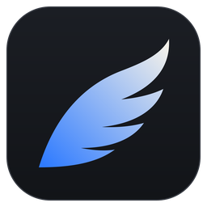
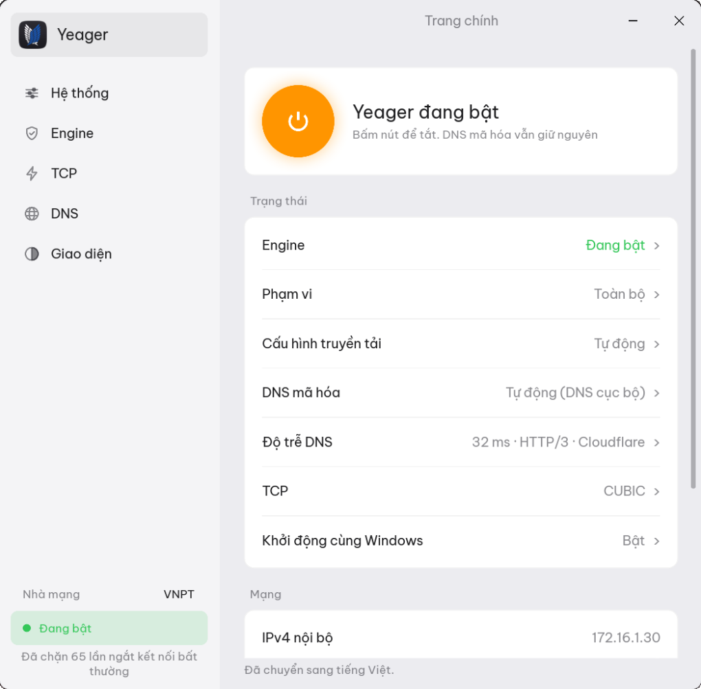
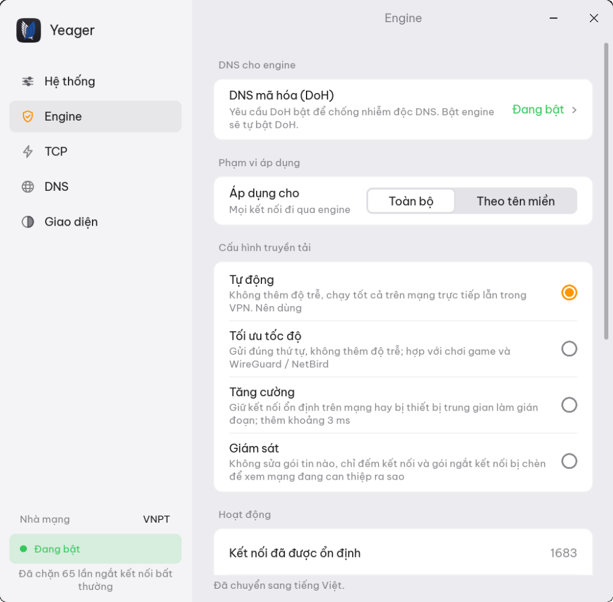
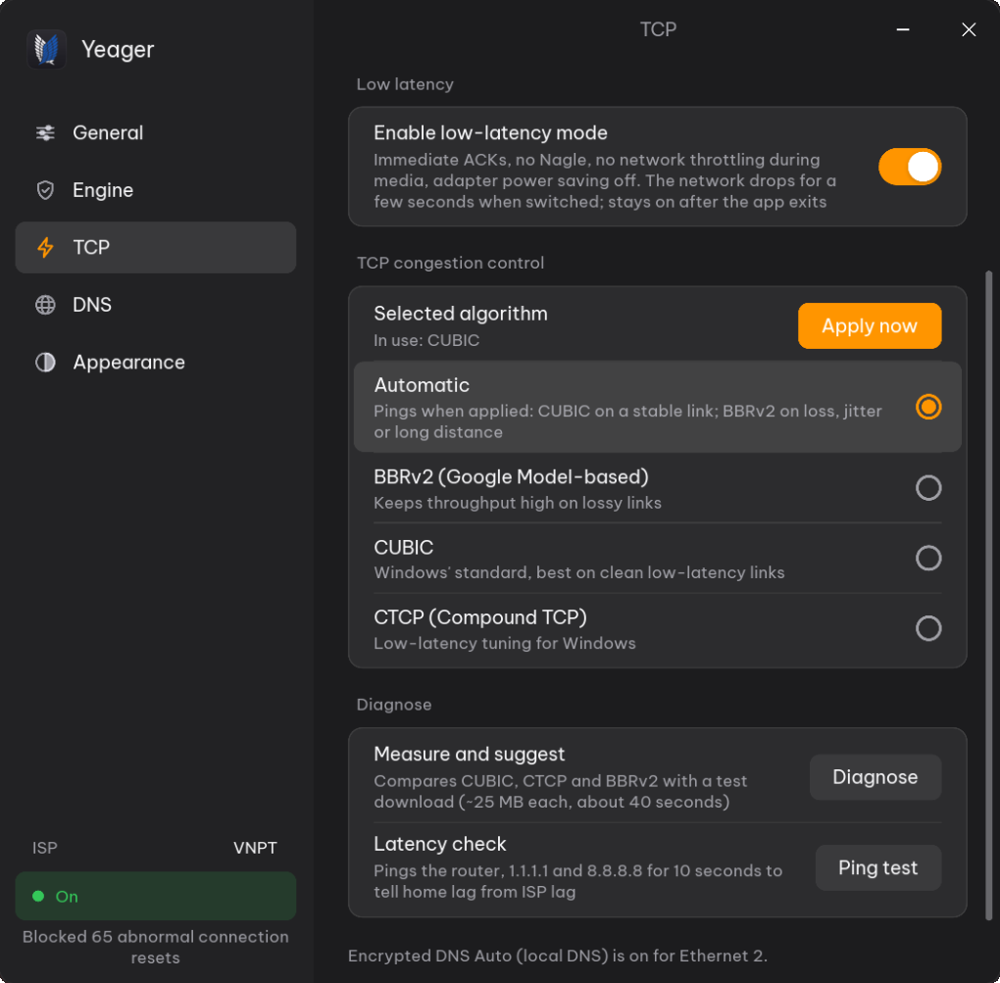
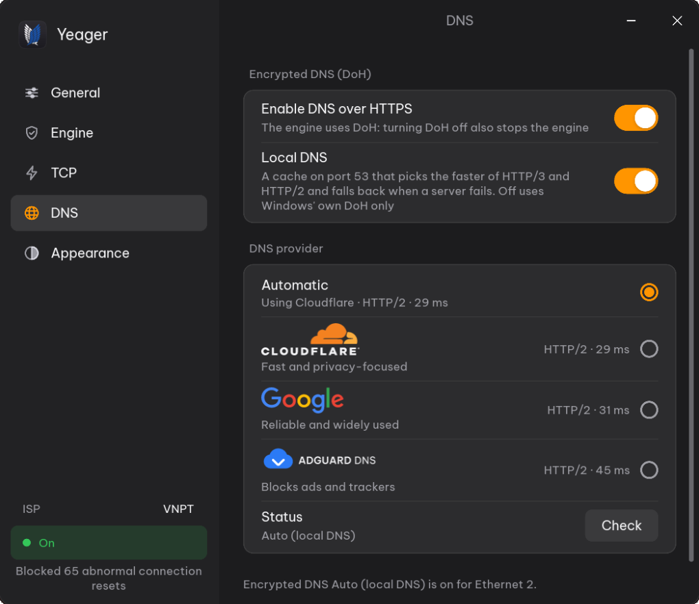

<div align="center">



# Yeager

**Internet mượt và thông thoáng hơn trên Windows 11, chỉ với một nút bấm.**<br>
Engine kết nối, tối ưu TCP và DNS mã hóa trong một ứng dụng gốc. Không phải VPN: lưu lượng vẫn đi thẳng tới trang web, bằng chính IP của bạn.

[English](README.md) · **Tiếng Việt**

[](https://gitlab.com/cino-group/yeager/-/releases)


[](LICENSE)

### ⬇ Tải bộ cài: [từ GitHub](https://github.com/iamcino/Yeager/releases/latest) · [từ GitLab](https://gitlab.com/cino-group/yeager/-/releases/permalink/latest/downloads/Yeager-Setup.exe)

Trang phát hành: [GitHub](https://github.com/iamcino/Yeager/releases) · [GitLab](https://gitlab.com/cino-group/yeager/-/releases) · [Có gì mới](CHANGELOG.vi.md) · [Báo lỗi](https://github.com/iamcino/Yeager/issues)



</div>

---

## Bắt đầu trong một phút

1. **Tải** `Yeager-Setup-<phiên bản>.exe` [từ GitHub](https://github.com/iamcino/Yeager/releases/latest) hoặc [từ GitLab](https://gitlab.com/cino-group/yeager/-/releases/permalink/latest/downloads/Yeager-Setup.exe), chạy nó và đồng ý cấp quyền Admin.
2. **Bấm nút nguồn** ở trang chính. Yeager bật DNS mã hóa và engine kết nối.
3. **Lướt web như bình thường.** Những trang trước đây hay treo hoặc bị ngắt giờ tải bình thường.

Vậy là xong. Biểu tượng Yeager nằm ở khay hệ thống (góc phải thanh tác vụ);
đóng cửa sổ thì Yeager vẫn chạy. Nếu Windows hay phần mềm diệt virus hiện
cảnh báo, xem [Cảnh báo của Windows và phần mềm diệt virus](#cảnh-báo-của-windows-và-phần-mềm-diệt-virus).

> Không muốn cài? Bản portable (`Yeager-<phiên bản>-portable-x64.zip`) chạy
> từ thư mục nào cũng được và tự cập nhật y như bản cài.

## Vì sao chọn Yeager

| | |
|---|---|
| 🌐 **Trang web tải lại được** | Levi, engine kết nối, giúp các kết nối HTTPS hay bị mạng ngắt hoặc làm treo đi qua được, cho mọi trang hoặc chỉ những trang bạn chọn. |
| 🚀 **Không phải VPN** | Không proxy, không máy chủ trung gian, không cài thêm chứng chỉ. Lưu lượng đi thẳng tới trang web bằng IP của bạn và vẫn mã hóa đầu cuối, nên tốc độ và độ trễ giữ nguyên. |
| 🔒 **DNS riêng tư** | Hange phân giải tên miền qua DNS over HTTPS (HTTP/3 hoặc HTTP/2) với Cloudflare, Google hoặc AdGuard, và không bao giờ lùi về DNS không mã hóa. |
| ⚡ **TCP nhanh hơn** | Erwin đo đường truyền và chọn thuật toán điều khiển tắc nghẽn tốt nhất của Windows: BBRv2, CUBIC hoặc CTCP. |
| ↩️ **Hoàn tác được hết** | Mọi thay đổi TCP và DNS đều được lưu trước, rồi trả lại khi bạn tắt Yeager, thoát, hoặc mở lại sau khi máy bị tắt đột ngột. |
| 🪶 **Nhẹ và thuần** | Một file Rust duy nhất, driver mạng nhúng sẵn. Không dịch vụ, không script, không runtime, tốn ít bộ nhớ. |
| 🛡️ **Cập nhật an toàn** | Báo khi có bản mới, luôn hỏi trước khi cài, và đối chiếu file tải về với danh sách SHA-256 của bản phát hành. |

## Tính năng

### Levi: engine kết nối

- **Hai phạm vi.** *Toàn bộ* áp dụng cho mọi kết nối HTTPS đi ra. *Theo tên
  miền* chỉ áp dụng cho các tên miền bạn thêm (gồm cả tên miền con, ví dụ
  `discord.com` hay `medium.com`); mọi trang khác đi thẳng.
- **Bốn cấu hình.** *Tự động* (mặc định) và *Tối ưu tốc độ* không thêm độ trễ,
  hợp với chơi game, cáp quang và đường hầm VPN như WireGuard hay NetBird.
  *Tăng cường* dành cho mạng can thiệp mạnh hơn. *Giám sát* không thay đổi gì,
  chỉ đếm những gì mạng đang làm, để kiểm tra an toàn.
- **Chống can thiệp.** Gói reset do mạng chèn vào trước khi máy chủ thật kịp
  trả lời bị bỏ, nên kết nối vẫn mở để nhận phản hồi thật. Máy chủ thật đóng
  kết nối thì luôn được cho qua.
- **Không động tới mạng nội bộ.** Địa chỉ riêng, cục bộ, và thiết bị IPv6 cùng
  mạng /64 như NAS hay TV đi thẳng với tốc độ mạng LAN.
- **Chịu tải lớn.** Trang mở 20–30 kết nối cùng lúc, tải file, video 4K hay
  game vẫn giữ tốc độ; chỉ gói mở đầu kết nối mới được xem xét.
- **Thân thiện với phần mềm diệt virus.** Không chèn gói giả hay cờ TCP bất
  thường, và không bao giờ động tới DNS (cổng 53 và DNS mã hóa của chính Yeager).
- **Bộ đếm trực tiếp** ở trang Engine: số kết nối đã xử lý, đã ổn định, và số
  gói reset giả đã bỏ.

### Erwin: tối ưu TCP

- Chọn **Tự động**, **BBRv2**, **CUBIC** hoặc **CTCP**. *Tự động* đo ping tới
  Cloudflare và Google khi áp dụng: mạng ổn định dùng CUBIC; mất gói, dao động
  hoặc đường xa dùng BBRv2.
- **Chẩn đoán** đo băng thông và độ trễ khi tải với từng thuật toán rồi đề xuất
  cái nhanh nhất, áp dụng chỉ với một cú bấm.
- **Khôi phục mặc định Windows** trả lại thiết lập gốc của bạn, hoặc mặc định
  của Windows, bất kỳ lúc nào.
- Chạy độc lập, không cần engine hay DNS.

### Hange: DNS mã hóa

- **Cloudflare**, **Google**, **AdGuard** (chặn quảng cáo và trình theo dõi),
  hoặc **Tự động**: dùng bên trả lời nhanh hơn giữa Cloudflare và Google.
- **Bộ phân giải cục bộ** ở `127.0.0.1` và `[::1]` với bộ nhớ đệm 4096 bản ghi.
  Nó thử cùng lúc mọi địa chỉ máy chủ qua HTTP/3 và HTTP/2 rồi giữ sẵn đường
  nhanh nhất, nên tra cứu trả lời ngay.
- **Chịu được sự cố.** Trang vừa vào được trả lời từ bộ nhớ đệm, và nếu nhà
  cung cấp lỗi quá 10 giây, một nhà cung cấp khác tạm thay cho tới khi nó trở lại.
- **Không lùi về DNS thường.** Nếu bộ phân giải cục bộ dừng, DoH có sẵn của
  Windows vẫn giữ DNS được mã hóa.
- **Kiểm tra** cho biết đang dùng giao thức nào và DNS có bị rò rỉ không.

### Ứng dụng

- Giao diện tiếng Việt hoặc tiếng Anh, sáng hoặc tối, tùy chọn màu nhấn.
- **Tự kết nối khi mở** và **khởi động cùng Windows** mà không hỏi UAC mỗi lần đăng nhập.
- Hiện nhà mạng của bạn ở thanh bên.
- Engine luôn chạy cùng DNS mã hóa: bật engine là bật DoH. DoH và tối ưu TCP
  thì chạy riêng được.

| Engine (Levi) | Tối ưu TCP (Erwin) | DNS mã hóa (Hange) |
|:---:|:---:|:---:|
|  |  |  |

## Mẹo nhanh

| Để… | Làm thế này |
|---|---|
| Bật hoặc tắt tất cả | Nút nguồn ở trang chính (bấm vào logo để về đó) |
| Chỉ dùng engine cho vài trang | **Engine** › **Áp dụng cho** › *Theo tên miền*, rồi thêm tên miền |
| Chọn thiết lập TCP tốt nhất cho mạng | **TCP** › **Chẩn đoán** › **Áp dụng đề xuất** |
| Xác nhận DNS đã mã hóa | **DNS** › **Kiểm tra** |
| Hoàn tác mọi thay đổi TCP | **TCP** › **Khôi phục mặc định Windows** |
| Kiểm tra bản mới ngay | **Hệ thống** › **Cập nhật** › **Kiểm tra** |

## Yêu cầu hệ thống

- **Windows 11 x64** (build 22000 trở lên) hoặc **Windows Server 2022** (build 20348 trở lên).
- **Quyền Admin**: đổi thiết lập TCP, DNS và nạp driver mạng là thao tác cấp
  hệ thống. Ứng dụng hỏi một lần khi khởi động.
- BBRv2 cần Windows 11 22H2 trở lên; bản cũ hơn tự chuyển về CUBIC hoặc CTCP.

Yeager không hỗ trợ và sẽ không hỗ trợ Windows 10. Windows 10 đã hết cập nhật
bảo mật, điều rất quan trọng với phần mềm chạy quyền Admin kèm driver mạng, và
thiếu các API DNS over HTTPS gốc mà Yeager dựa vào. Cả bộ cài lẫn ứng dụng đều
từ chối chạy trên Windows cũ.

## Cập nhật

Yeager kiểm tra bản mới khi khởi động và cứ 6 tiếng một lần. Khi có bản mới,
**↑ Cập nhật lên …** hiện ở thanh bên và menu khay. Không có gì được cài cho tới
khi bạn bấm **Cập nhật**. Lúc đó Yeager tải `yeager.exe` mới, đối chiếu với
`SHA256SUMS.txt` của bản phát hành, thay file đang chạy, khôi phục TCP và DNS,
rồi khởi động lại (engine bật lại nếu trước đó đang bật).

Kiểm tra ngay: **Hệ thống › Cập nhật › Kiểm tra**. Muốn tắt tự kiểm tra thì tắt
ở cùng chỗ đó.

Trình cập nhật trong ứng dụng đọc bản phát hành từ GitHub. Nếu mạng của bạn
không vào được GitHub, hãy tải bộ cài mới nhất [từ GitLab](https://gitlab.com/cino-group/yeager/-/releases/permalink/latest/downloads/Yeager-Setup.exe)
và cài đè lên bản hiện tại; thiết lập của bạn được giữ nguyên.

## Câu hỏi thường gặp

**Yeager có phải VPN không? Có ẩn IP của tôi không?**
Không. Kết nối của bạn đi thẳng tới trang web bằng chính IP của bạn. Yeager
không giúp bạn ẩn danh.

**Có làm chậm game không?**
Không đáng kể. Nếu muốn engine hoàn toàn không động tới game, hãy dùng phạm vi
*Theo tên miền* để nó chỉ làm việc với những trang bạn chọn.

**Yeager có thu thập dữ liệu không?**
Không tài khoản, không telemetry, không phân tích, không quảng cáo. Thiết lập
nằm ở `%LOCALAPPDATA%\Yeager`. Kết nối duy nhất Yeager tự tạo là tới nhà cung
cấp DNS của bạn, tới Cloudflare một lần khi mở để biết nhà mạng, tới GitHub để
kiểm tra cập nhật, và tới Cloudflare, Google khi bạn bấm **Chẩn đoán** hoặc
dùng *Tự động*. Xem [chính sách quyền riêng tư](PRIVACY.md#tiếng-việt).

**Sao lại có cả GitHub và GitLab?**
Mỗi bản phát hành được đăng ở cả hai nơi. Nếu mạng của bạn không vào được nơi
này thì tải ở nơi kia. Mã nguồn cũng có ở cả
[GitHub](https://github.com/iamcino/Yeager) và [GitLab](https://gitlab.com/cino-group/yeager).

**Có gì đó không chạy nữa. Làm sao hoàn tác tất cả?**
Tắt Yeager, hoặc thoát nó: TCP và DNS trở về như cũ. **TCP › Khôi phục mặc
định Windows** còn đưa TCP về mặc định của Windows.

**Gỡ cài đặt thế nào?**
Tắt Yeager trước, rồi vào **Cài đặt › Ứng dụng › Yeager › Gỡ cài đặt**. Trình
gỡ dừng Yeager, xóa tác vụ khởi động và xóa `%LOCALAPPDATA%\Yeager`. Nếu còn
sót gì, Yeager sẽ khôi phục ở lần mở tiếp theo khi bạn cài lại.

**Có bản dòng lệnh không?**
`levi.exe` chạy engine kết nối không cần giao diện, dùng cho máy chủ và script.
File này không nằm trong bản tải về thông thường; hãy tự build từ mã nguồn theo
hướng dẫn ở [`crates/levi/CLI.vi.md`](crates/levi/CLI.vi.md).

## Xử lý sự cố

### Cảnh báo của Windows và phần mềm diệt virus

Bản phát hành của Yeager có chữ ký số, nhưng bằng chứng chỉ riêng của dự án
chứ không phải chứng chỉ thương mại. Vì vậy lần đầu Windows có thể báo
"Windows protected your PC" hoặc "Unknown publisher". Bấm **More info › Run anyway**.

Một số phần mềm diệt virus cũng theo dõi Yeager kỹ hơn, vì nó nạp driver mạng
WinDivert và chạy bộ phân giải DNS cục bộ. Hãy cho phép `yeager.exe` trong
phần mềm diệt virus và tường lửa. Để chắc file bạn tải là bản thật:

- **Chỉ tải** từ trang phát hành chính thức trên [GitHub](https://github.com/iamcino/Yeager/releases) hoặc [GitLab](https://gitlab.com/cino-group/yeager/-/releases).
- **Kiểm tra chữ ký:** mở PowerShell trong thư mục chứa file và chạy
  `(Get-AuthenticodeSignature .\yeager.exe).SignerCertificate.Thumbprint`.
  Với các bản hiện tại, kết quả phải là `9131F99C0B198E81FBA0F5818D0637B4A14D4CF1`.
- **Kiểm tra mã hash** với `SHA256SUMS.txt` của cùng bản phát hành.

Mọi thumbprint Yeager từng dùng, kết quả VirusTotal và danh sách đầy đủ các
địa chỉ mạng có trong [SECURITY.md](SECURITY.md#kiểm-tra-bản-tải-về).

### Một trang vẫn không vào được

- Kiểm tra engine và DNS mã hóa đều đang bật, rồi chạy **DNS › Kiểm tra**.
- Ở trang **Engine**, thử cấu hình *Tăng cường*; một số mạng cần nó.
- Với *Theo tên miền*, kiểm tra tên miền của trang đã có trong danh sách. Trang
  web thường tải thêm từ tên miền khác (ảnh, video, API); hãy thêm cả những tên
  miền đó, hoặc chuyển sang *Toàn bộ*.

### Mạng có vẻ chậm hơn

Chạy **TCP › Chẩn đoán** và áp dụng đề xuất, hoặc bấm **Khôi phục mặc định
Windows**. Nếu bạn đang ở trong đường hầm VPN, dùng cấu hình *Tự động* hoặc
*Tối ưu tốc độ*.

## Dành cho lập trình viên

Yeager viết bằng Rust, giao diện [Slint](https://slint.dev), chia thành các
crate: `app` (giao diện, khay, điều phối), `levi` (engine kết nối trên
WinDivert), `erwin` (TCP), `hange` (DNS over HTTPS) và `common`.

```
 Trình duyệt / ứng dụng
       │
       ▼
 Windows TCP/IP ──── Erwin: điều khiển tắc nghẽn (BBRv2 / CUBIC / CTCP)
       │
       ├── DNS ────► Hange: bộ phân giải cục bộ ──► DoH (HTTP/3 hoặc HTTP/2) ──► Cloudflare / Google / AdGuard
       │
       └── HTTPS ──► Levi: engine kết nối (Toàn bộ / Theo tên miền) ──► Internet
```

- [Tài liệu thiết kế](docs/DESIGN.vi.md): từng phần hoạt động thế nào và vì sao.
- [Build và phát hành](docs/BUILD.vi.md): build từ mã nguồn, bộ cài, ký số, và đăng bản phát hành trên GitHub, GitLab.
- [Đóng góp](CONTRIBUTING.md#tiếng-việt): báo lỗi và gửi pull request.

## Giấy phép và ghi công

Copyright (C) 2026 Cino and the Yeager contributors

Yeager là phần mềm tự do, mã nguồn mở theo [giấy phép MIT](LICENSE). Ứng dụng
có kèm thành phần bên thứ ba theo giấy phép riêng: driver WinDivert (LGPL v3),
bộ công cụ Slint (Slint Royalty-free License 2.0), font Be Vietnam Pro (SIL OFL
1.1) và các crate Rust, phần lớn là MIT hoặc Apache-2.0. Chi tiết ở
[THIRD-PARTY-NOTICES.md](THIRD-PARTY-NOTICES.md).

Yeager được cung cấp "nguyên trạng", không kèm bảo đảm. Bạn tự chịu trách nhiệm
dùng Yeager đúng pháp luật nơi bạn ở và điều khoản của nhà mạng. Đây là dự án
độc lập, không liên kết với Microsoft, Cloudflare, Google, WinDivert, Slint hay
*Attack on Titan*. Xem [miễn trừ trách nhiệm](DISCLAIMER.md) và
[chính sách bảo mật](SECURITY.md#tiếng-việt).

<p align="center">
  <a href="https://slint.dev">
    <picture>
      <source media="(prefers-color-scheme: dark)" srcset="assets/icons/made-with-slint-dark.svg">
      <source media="(prefers-color-scheme: light)" srcset="assets/icons/made-with-slint-light.svg">
      
    </picture>
  </a>
</p>
