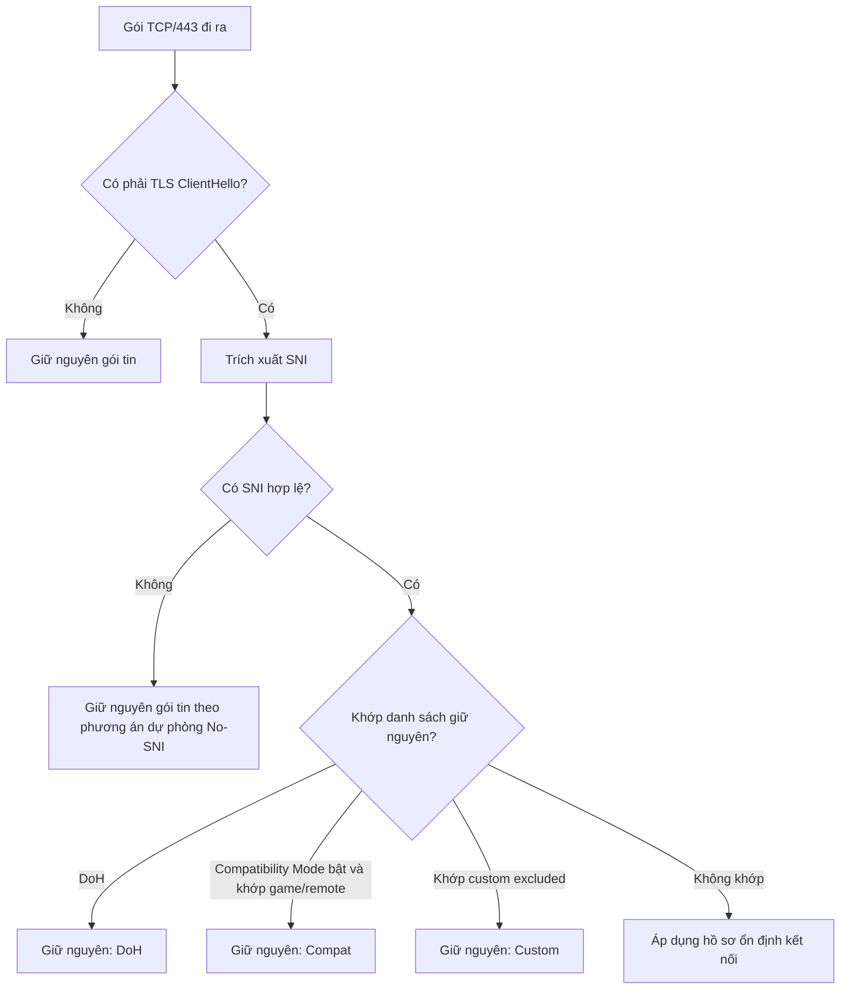

# Yeager v1.1.1 – Compatibility Mode & Domain Management

**Tệp đặc tả:** `docs/specs/yeager-v1.1.1-compatibility-mode.md`  
**Trạng thái:** Sẵn sàng triển khai  
**Phạm vi:** `crates/levi`, `crates/app`, `crates/common`  
**Mục tiêu:** Khắc phục lỗi tương thích với UltraViewer và các công cụ kết nối từ xa; thu gọn giao diện quản lý tên miền.

---

## 1. Nguyên tắc ngôn ngữ

Tài liệu này dùng ngôn ngữ kỹ thuật trung tính. Các cách diễn đạt dưới đây được ưu tiên:

| Không dùng | Dùng thay thế |
|---|---|
| sau khi nhận được phản hồi từ quý cộng đồng | sau khi nhận được phản hồi |
| can thiệp vào mọi kết nối | làm việc với mọi kết nối |
| bypass | giữ nguyên kết nối / tương thích |
| chặn | lọc / xử lý |
| tấn công | hành vi không tương thích |
| nguy hiểm | rủi ro cao |
| tuyệt đối | bắt buộc / mặc định |
| an toàn tuyệt đối | giảm thiểu rủi ro |
| sập mạng | gián đoạn kết nối |
| hỏng ứng dụng | ứng dụng không hoạt động đúng |
| anti-cheat | hệ thống toàn vẹn ứng dụng |
| false ban | cảnh báo không đúng |
| drop packet | loại bỏ gói tin |
| kill process | kết thúc tiến trình |

---

## 2. Bối cảnh kỹ thuật

Sau khi nhận được phản hồi, ghi nhận hai vấn đề:

1. Một số công cụ kết nối từ xa như UltraViewer, TeamViewer, RustDesk có thể báo lỗi `Cannot get ID` khi Yeager bật ở chế độ làm việc với mọi kết nối.
2. Trang Engine hiển thị danh sách tên miền trực tiếp khiến giao diện dài và kém gọn.

Nguyên nhân chính:

- Một số tên miền dịch vụ kết nối từ xa chưa nằm trong danh sách giữ nguyên kết nối.
- Một số ứng dụng sử dụng TLS ClientHello không có SNI, ví dụ kết nối trực tiếp theo IP. Nếu tiếp tục xử lý theo hồ sơ chung, kết nối có thể không hoàn tất.

---

## 3. Phạm vi và ràng buộc

- Chỉ xử lý TCP/443.
- UDP/QUIC không nằm trong phạm vi xử lý của phiên bản này.
- Không mở handle tiến trình.
- Không đọc bộ nhớ ứng dụng.
- Không thu thập hoặc gửi dữ liệu người dùng ra ngoài.
- Không loại bỏ gói tin ngoài luồng xử lý đã định nghĩa.
- Mọi gói tin không thuộc diện xử lý đặc biệt phải được giữ nguyên (`send_raw`).

---

## 4. Luồng xử lý đề xuất



---

## 5. Thay đổi tại `crates/levi`

### 5.1. Hợp nhất danh sách giữ nguyên

Tách bạch giữa danh sách DoH (luôn bật) và danh sách tương thích ứng dụng/game:

```rust
pub const BUILTIN_DOH_DOMAINS: &[&str] = &[
    "cloudflare-dns.com",
    "dns.google",
    "dns.quad9.net",
    "one.one.one.one",
    "dns.adguard-dns.com",
    "dns.adguard.com",
];

pub const UNIFIED_COMPAT_DOMAINS: &[&str] = &[
    // Remote tools
    "ultraviewer.net",
    "uvnc.com",
    "ultraviewer.com",
    "teamviewer.com",
    "teamviewer.de",
    "tvv.su",
    "anydesk.com",
    "anydesk.net",
    "adsk.me",
    "rustdesk.com",
    "rdp.rs",
    "parsec.app",
    "parsecgaming.com",
    "splashtop.com",

    // Game platforms
    "ubi.com",
    "ubisoft.com",
    "ubisoftconnect.com",
    "uplay.com",
    "ubi.li",
    "riotgames.com",
    "pvp.net",
    "leagueoflegends.com",
    "valgame.net",
    "battle.net",
    "blizzard.com",
    "ea.com",
    "origin.com",
    "epicgames.com",
    "unrealengine.com",
    "steamcontent.com",
    "steampowered.com",
    "steamcommunity.com",
    "steamstatic.com",
    "xboxlive.com",
    "playfabapi.com",
];
```

Quy tắc khớp:
- Tái sử dụng hàm `matches_host(sni, target)` hiện có trong `crates/levi` (so khớp chính xác hoặc hậu tố `.target`, không phân biệt hoa thường, zero-allocation).
- Không dùng regex trong luồng xử lý chính.

### 5.2. Hàm đánh giá tập trung

Định nghĩa enum lý do giữ nguyên và hàm đánh giá duy nhất:

```rust
#[derive(Debug, Clone, Copy, PartialEq, Eq)]
pub enum PassThroughReason {
    Doh,
    Compat,
    Custom,
    NoSni,
}

pub fn evaluate_pass_through(
    sni: Option<&str>,
    compat_mode: bool,
    custom_excluded: &[String],
) -> Option<PassThroughReason> {
    let s = match sni {
        Some(s) if !s.trim().is_empty() => s.trim().to_lowercase(),
        _ => return Some(PassThroughReason::NoSni),
    };

    if BUILTIN_DOH_DOMAINS.iter().any(|target| matches_host(&s, target)) {
        return Some(PassThroughReason::Doh);
    }

    if compat_mode && UNIFIED_COMPAT_DOMAINS.iter().any(|target| matches_host(&s, target)) {
        return Some(PassThroughReason::Compat);
    }

    if custom_excluded.iter().any(|target| matches_host(&s, target)) {
        return Some(PassThroughReason::Custom);
    }

    None
}
```

### 5.3. Phương án dự phòng khi không có SNI

Nếu TLS ClientHello không có SNI hoặc SNI rỗng:
- Giữ nguyên gói tin (`send_raw`).
- Tăng bộ đếm `STATS_NO_SNI_UNTOUCHED`.
- Không áp dụng phân mảnh hoặc điều chỉnh thời gian.

Lý do: một số ứng dụng kết nối trực tiếp theo IP hoặc dùng handshake đặc thù (như UltraViewer raw IP relay fallback). Việc phân mảnh có thể khiến kết nối không hoàn tất.

### 5.4. Bộ đếm nguyên tử

```rust
pub static STATS_DOH_UNTOUCHED: AtomicUsize = AtomicUsize::new(0);
pub static STATS_COMPAT_UNTOUCHED: AtomicUsize = AtomicUsize::new(0);
pub static STATS_CUSTOM_UNTOUCHED: AtomicUsize = AtomicUsize::new(0);
pub static STATS_NO_SNI_UNTOUCHED: AtomicUsize = AtomicUsize::new(0);
```

Tổng số kết nối giữ nguyên:
```rust
pub fn total_untouched() -> usize {
    STATS_DOH_UNTOUCHED.load(Ordering::Relaxed)
        + STATS_COMPAT_UNTOUCHED.load(Ordering::Relaxed)
        + STATS_CUSTOM_UNTOUCHED.load(Ordering::Relaxed)
        + STATS_NO_SNI_UNTOUCHED.load(Ordering::Relaxed)
}
```
*(Lưu ý: Giữ lại alias `STATS_BYPASSED` liên kết với tổng để đảm bảo tương thích ngược với code UI hiện tại).*

---

## 6. Thay đổi tại `crates/app` và `crates/common`

### 6.1. Config (`crates/common`)

Duy trì tương thích ngược 100% bằng Serde alias:

```rust
fn default_true() -> bool {
    true
}

#[derive(Debug, Clone, PartialEq, Eq, Serialize, Deserialize)]
#[serde(default)]
pub struct Config {
    // Tương thích ngược với v1.1.0 (game_protection_enabled)
    #[serde(alias = "game_protection_enabled", default = "default_true")]
    pub compatibility_mode_enabled: bool,

    #[serde(default)]
    pub custom_excluded_domains: Vec<String>,

    // Tương thích ngược với v1.0.x / v1.1.0 (hosts)
    #[serde(alias = "hosts", default)]
    pub selected_hosts: Vec<String>,

    // ... các trường cấu hình khác giữ nguyên
}
```

### 6.2. Trang Engine

Chỉ hiển thị tóm tắt, không hiển thị danh sách tên miền trực tiếp:

```text
┌─────────────────────────────────────────────┐
│ Engine                                      │
│                                             │
│ Compatibility Mode                    [ON]  │
│ Giữ nguyên kết nối cho game launcher và     │
│ công cụ kết nối từ xa phổ biến.             │
│                                             │
│ Custom exclusions: 3 domains       [Manage] │
│                                             │
│ Scope                                       │
│ ○ Làm việc với mọi kết nối                  │
│ ● Theo tên miền                             │
│                                             │
│ Selected hosts: 12 domains         [Manage] │
│                                             │
│ Profile                                     │
│ Tự động / Tối ưu độ trễ / Tăng cường /      │
│ Giám sát                                    │
│                                             │
│ Activity: 1,683 connections untouched       │
└─────────────────────────────────────────────┘
```

Quy tắc:
- Dòng `Selected hosts` chỉ hiển thị khi Scope là `Theo tên miền` (`Scope::HostList`).
- Không render danh sách domain inline trên trang Engine.
- Trang Engine phải vừa một màn hình 1080p, không cần cuộn.

### 6.3. Component `DomainListSheet`

Dùng một component chung cho hai loại danh sách:

```slint
export component DomainListSheet inherits Dialog {
    in property <string> title;
    in property <string> description;
    in property <[string]> domains;
    in property <bool> show-import-button;

    callback add_domain(string);
    callback remove_domain(string);
    callback import_suggested(string); // "game" | "remote" | "all"
    callback close();
}
```

Biến thể 1: Custom Excluded Domains
- Title: `Tên miền loại trừ tùy chỉnh`
- Description: `Các tên miền này được giữ nguyên, không áp dụng hồ sơ ổn định kết nối.`
- `show-import-button: false`

Biến thể 2: Selected Hosts
- Title: `Danh sách tên miền được xử lý`
- Description: `Yeager chỉ áp dụng hồ sơ ổn định kết nối cho các tên miền trong danh sách này.`
- `show-import-button: true` (Chỉ khả dụng khi Scope = `Theo tên miền`)

Hành vi import:
- Nút Import chỉ áp dụng cho sheet **Selected Hosts**. Danh sách game/remote được nạp vào `selected_hosts`, không nạp vào `custom_excluded_domains`.
- Cho phép chọn: `Nhập danh sách game`, `Nhập danh sách remote tools`, `Nhập tất cả`.
- Sau khi import: chuẩn hóa lowercase, khử trùng lặp và sắp xếp theo bảng chữ cái. Lưu config ngay sau khi import.

### 6.4. Kiểm tra đầu vào

Áp dụng cho cả hai sheet:
- Chuyển về chữ thường (`to_lowercase()`).
- Cắt khoảng trắng đầu/cuối (`trim()`).
- Chặn chuỗi rỗng.
- Chặn `*`, `.`, `..`.
- Chặn độ dài > 253 ký tự.
- Không thêm trùng lặp.
- Chuẩn hóa `*.example.com` thành `example.com`.

### 6.5. Lưu cấu hình & Flush khi đóng

- Ghi `config.json` với debounce 500 ms trong lúc gõ/sửa.
- **Quan trọng:** Khi callback `close()` hoặc phím Escape được gọi:
  - Hủy timer debounce đang chờ.
  - Lưu config ngay lập tức (Flush).
  - Đồng bộ trạng thái sang Levi cho kết nối tiếp theo mà không làm gián đoạn kết nối đang chạy.

### 6.6. Dashboard

Thêm dòng trạng thái:
```text
Compatibility: Bật
Untouched: 47 connections
```
- Click vào `Compatibility` ➔ mở trang Engine.
- `Untouched` hiển thị tổng số kết nối được giữ nguyên.

---

## 7. Tiêu chí nghiệm thu

### 7.1. Chức năng (Functional)

| # | Kiểm tra | Kết quả mong đợi |
|---|---|---|
| F1 | Mở UltraViewer với Compatibility Mode bật | Lấy được ID, không lỗi `Cannot get ID` |
| F2 | UltraViewer kết nối trực tiếp theo IP, không có SNI | Gói tin được giữ nguyên, `STATS_NO_SNI_UNTOUCHED` tăng |
| F3 | Tắt Compatibility Mode | Hành vi cũ được khôi phục, dùng để xác nhận tính năng đang hoạt động |
| F4 | Ubisoft Connect login với Compatibility Mode bật | Kết nối thành công |
| F5 | Riot client/launcher với Compatibility Mode bật | Kết nối thành công |
| F6 | DoH query với Compatibility Mode tắt | DoH vẫn được giữ nguyên |
| F7 | Truy cập google.com/facebook.com | Vẫn áp dụng hồ sơ ổn định kết nối |

### 7.2. Tương thích ngược (Backward Compatibility)

| # | Kiểm tra | Kết quả mong đợi |
|---|---|---|
| BC1 | Nâng cấp từ v1.1.0 có `game_protection_enabled = true` | v1.1.1 đọc thành `compatibility_mode_enabled = true` |
| BC2 | Nâng cấp từ bản cũ có `hosts` | v1.1.1 đọc thành `selected_hosts` |
| BC3 | File config không có trường mới | Dùng mặc định an toàn |

### 7.3. Giao diện & Thao tác (UI)

| # | Kiểm tra | Kết quả mong đợi |
|---|---|---|
| U1 | Trang Engine ở Scope `Làm việc với mọi kết nối` | Không hiện dòng `Selected hosts` |
| U2 | Trang Engine ở Scope `Theo tên miền` | Hiện dòng `Selected hosts` và nút `Manage` |
| U3 | Bấm `Manage` ở Custom exclusions | Mở sheet, thêm/xóa được domain |
| U4 | Bấm `Manage` ở Selected hosts | Mở sheet, import được danh sách gợi ý |
| U5 | Thêm domain trùng | Không thêm mới, báo lỗi hoặc highlight domain hiện có |
| U6 | Nhập `*` hoặc rỗng | Bị chặn |
| U7 | Escape | Đóng sheet |
| U8 | Enter trong ô nhập | Thêm domain |
| U9 | Delete khi row được focus | Xóa domain |
| U10 | Độ cao trang Engine | Vừa một màn hình 1080p |
| U11 | Thêm domain rồi bấm Close trong < 200 ms | Domain vẫn được lưu (Flush debounce) |
| U12 | Thêm domain rồi bấm Escape | Domain vẫn được lưu |
| U13 | Mở lại app | Danh sách domain còn nguyên |

### 7.4. Import

| # | Kiểm tra | Kết quả mong đợi |
|---|---|---|
| I1 | Bấm “Nhập danh sách game” | `selected_hosts` tăng đúng các domain game |
| I2 | Bấm import 2 lần | Không có domain trùng lặp |
| I3 | Import xong | Danh sách được sort alphabetically |
| I4 | Scope = `Làm việc với mọi kết nối` | Nút Import bị ẩn hoặc disable |

### 7.5. Hiệu năng & Độ bền (Performance & Robustness)

| # | Chỉ số / Kiểm tra | Ngưỡng / Kết quả mong đợi |
|---|---|---|
| P1 | `evaluate_pass_through` | p50 < 1 µs, p99 < 5 µs |
| P2 | `parse_client_hello` + SNI extract | p50 < 0.5 µs |
| P3 | Tổng luồng xử lý chính | < 20 µs |
| P4 | Debounce lưu config | 500 ms ± 50 ms |
| S1 | Fuzz `parse_client_hello` với payload ngẫu nhiên | Không gây lỗi dừng chương trình |
| S2 | Payload không đúng cấu trúc | Trả về `sni: None`, đi vào phương án dự phòng |
| S3 | `config.json` bị lỗi định dạng | Ứng dụng khởi động an toàn, dùng cấu hình mặc định |
| S4 | Người dùng cũ cập nhật | Không hiển thị lại onboarding |

---

## 8. Giới hạn đã biết

Tài liệu công khai cần ghi rõ:

1. Phiên bản này chỉ xử lý TCP/443. UDP/QUIC không được xử lý.
2. Compatibility Mode giảm rủi ro tương thích bằng cách không mở handle tiến trình và không đọc bộ nhớ ứng dụng. Tuy nhiên, không khẳng định vô hình trước mọi hệ thống toàn vẹn ứng dụng.
3. Nếu máy chủ đích bật Encrypted Client Hello, SNI có thể không trích xuất được. Khi đó, kết nối được giữ nguyên và không áp dụng hồ sơ ổn định.
4. Danh sách `UNIFIED_COMPAT_DOMAINS` là danh sách khởi tạo tĩnh trong phiên bản này. Người dùng có thể tự thêm tên miền qua Custom Excluded Domains.
